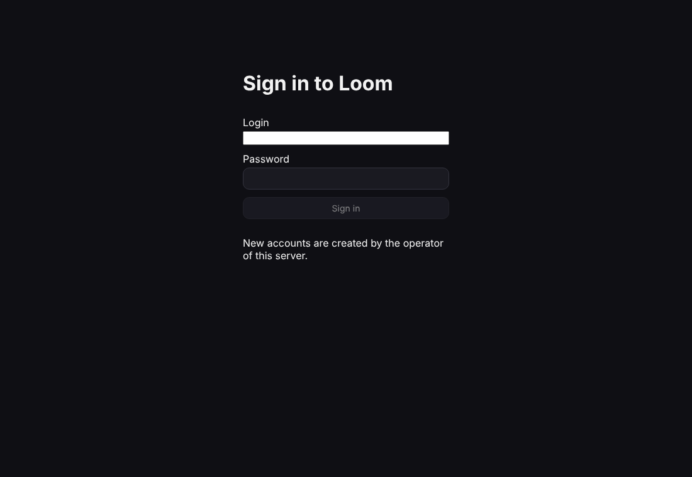
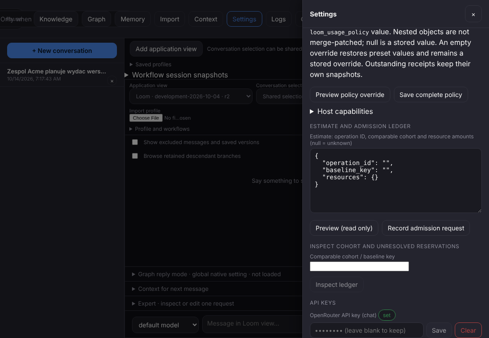

# Pierwsze kroki

Krótko, od pustego serwera do pierwszej rozmowy. Każdy krok oznaczam: **sprawdzone** (przeszedłem go naprawdę,
skrypt `deploy/first-steps-check.sh`) albo **nie sprawdzone** (opisane z kodu i dokumentów, bez telefonu).
Napisy w przeglądarce są dziś po angielsku, więc podaję je w cudzysłowie.

Słowa: **konto** to Twoje miejsce na serwerze. **Rozmowa** to okienko czatu. **Węzeł** to jedna rzecz w grafie
(osoba, temat, wiadomość), **graf** to wszystkie węzły i połączenia między nimi. **Akcja** to coś, co aplikacja
robi na rozmowie albo wiadomości (streść, przetłumacz). **Pamięć** to to, co aplikacja dokłada do pytania, żeby
model wiedział, o czym mówisz. **Magazyn** to miejsce, gdzie leżą pliki i kopie. **Ustawienia** to wszystko, co
da się zmienić; nic nie jest zaszyte na stałe.

## 1. Postaw serwer na VPS (sprawdzone, bez systemd i Caddy)

Potrzebujesz maszyny z Debianem 12+ lub Ubuntu 22.04+ i otwartych portów 80 i 443. Najprościej gotowa paczka:

1. W GitHubie: Actions, „Package (Android APK + server)”, „Run workflow”. Po zakończeniu pobierz artefakt
   `chatadhd-server-linux-x64` (Intel/AMD) albo `chatadhd-server-linux-arm64` (`uname -m` pokaże `x86_64` albo `aarch64`).
   W środku jest `.tar.gz` i `.sha256`; wgraj oba na VPS.
2. Na VPS: `git clone <repo> && cd chatadhd`, potem
   `sudo deploy/install.sh --from-tarball chatadhd-server-linux-x64-<wersja>.tar.gz --domain chat.twoja.domena --admin-login anna`
   (bez `--domain` będzie certyfikat wewnętrzny i ostrzeżenie w przeglądarce). Skrypt zapyta o hasło (min. 8 znaków),
   zainstaluje usługę i Caddy (HTTPS).
3. Zamiast paczki możesz zbudować ze źródeł: to samo polecenie bez `--from-tarball` (kilka minut).

Sprawdzone: paczka zbudowana dokładnie tak, jak robi to workflow (`install.sh --package`), rozpakowana
`install.sh --from-tarball` do świeżego katalogu, serwer wstał i odpowiada. Nie sprawdzone: część z `apt`, systemd
i Caddy (wymaga prawdziwego VPS z rootem). Szczegóły: `deploy/README.md`.

## 2. Załóż konto (sprawdzone)

Najprościej flagą `--admin-login anna` z kroku 1. Później dodatkowe konta: `sudo /opt/chatadhd/chatadhd-user add bartek`
(hasło wpisujesz w terminalu; nie trafia do logów). Lista: `chatadhd-user list`. Domyślnie rejestracja jest
**zamknięta** (konta zakłada właściciel). Zmiana na zaproszenia: `--registration invite`, kod: `chatadhd-user invite`.

## 3. Otwórz web (sprawdzone w Chromium)

Wejdź na `https://chat.twoja.domena`. Zobaczysz „Sign in to Loom”: wpisz login i hasło („Sign in”). Po zalogowaniu
jest okienko rozmowy, a u góry zakładki („Graph”, „Memory”, „Import”, „Settings”…). Sesja zostaje w przeglądarce.

## 4. Telefon (nie sprawdzone: nie miałem telefonu)

1. W Actions pobierz artefakt, rozpakuj na telefonie i otwórz `.apk` (zezwól na instalację z tego źródła).
   Artefakt `chatadhd-android-apk-TEST-KEY` to klucz testowy (tylko do spróbowania), a `chatadhd-android-apk-release`
   to Twój klucz wydania. Kolejne wersje instalują się na poprzednią tylko przy tym samym kluczu (patrz
   `deploy/README.md`, „Instalacja APK”).
   - **Własny klucz wydania (raz).** Na swoim komputerze (potrzebny Java/`keytool`):
     `keytool -genkeypair -v -keystore chatadhd-release.jks -alias chatadhd -keyalg RSA -keysize 4096 -validity 10000`
     (wymyśl hasło i zapisz je). Zamień plik na tekst: `base64 -w0 chatadhd-release.jks` (na macOS: `base64 -i chatadhd-release.jks`).
     Na GitHubie: repo → Settings → Secrets and variables → Actions → New repository secret, cztery sekrety:
     `ANDROID_KEYSTORE_BASE64` (ten tekst), `ANDROID_KEYSTORE_PASSWORD` (hasło pliku),
     `ANDROID_KEY_ALIAS` (`chatadhd`), `ANDROID_KEY_PASSWORD` (hasło klucza; to samo, jeśli nie podałeś innego).
     Gdy są wszystkie cztery, workflow podpisuje APK Twoim kluczem; bez żadnego z nich zostaje klucz testowy;
     gdy jest tylko część, przebieg kończy się błędem z listą brakujących.
   - **Nie zgub pliku `.jks` ani haseł** (kopia w menedżerze haseł i na dysku offline). Bez nich nie da się podpisać
     aktualizacji tym samym kluczem i telefon nie zainstaluje nowej wersji na starą: zostaje odinstalować (to kasuje dane aplikacji).
     Nigdy nie wkładaj pliku do repozytorium.
   - **Pierwsze przejście z klucza testowego na własny** wymaga jednorazowego odinstalowania aplikacji z kluczem
     testowym (Android nie zmieni klucza „w miejscu”). Najpierw przenieś dane (patrz `deploy/README.md`).
2. Przy pierwszym uruchomieniu wybierz „Konto na serwerze” (później: ikona ⚙ w prawym dolnym rogu).
3. Wpisz adres (`chat.twoja.domena`), „Sprawdź i zapisz”: aplikacja pyta serwer i pokazuje powód, jeśli się nie da.
4. Zaloguj się kontem z kroku 2. Wymagany jest HTTPS; zwykły HTTP tylko po zaznaczeniu opcji i tylko w sieci lokalnej.
5. Powrót do „Lokalnie” niczego nie kasuje. Gdzie aplikacja trzyma dane: ⚙, „Lokalizacja danych…”.

## 5. Klucz dostawcy w Ustawieniach (sprawdzone w Chromium)

Menu **⋮** w prawym górnym rogu czatu → „Ustawienia” („Settings”, gdy przeglądarka jest po angielsku; w Warsztacie to zakładka w nagłówku), sekcja „API KEYS”, pole „OpenRouter API key (chat)”: wklej klucz, „Save”; obok pojawi się
„set”. Wyżej są „Base URL” (domyślnie OpenRouter) i „Default model”. Klucz jest zapisany po stronie serwera, w katalogu
Twojego konta. Nic nie jest wysyłane, dopóki sam nie wyślesz wiadomości.

Test robiłem na lokalnym fałszywym dostawcy. Uwaga: serwer z kontami **nie łączy się z adresami prywatnymi**
(127.0.0.1, 192.168.x.x) jako z dostawcą. To ochrona; jeśli chcesz własny model w sieci, dopisz jego adres do
`allow_private_hosts` w `<dane>/profiles/server_accounts.pack`.

## 6. Pięć rzeczy do sprawdzenia z okienka rozmowy (sprawdzone na fałszywym dostawcy)

Najpierw napisz zwykłą wiadomość, żeby rozmowa miała treść. Polecenie wpisujesz w okienku jak zwykły tekst. Aplikacja
rozpoznaje je lokalnie (bez pytania modelu), pokazuje **propozycję** (co zrobi, ile to kosztuje) i czeka. Klikasz
„Run it” (albo piszesz „tak”); „Drop it” (albo „nie”) odrzuca.

1. **„Streść tę rozmowę”**: propozycja „Streść”, po „Run it” streszczenie w rozmowie.
2. **„Przetłumacz tę rozmowę na niemiecki”**: tłumaczenie. Samo „Przetłumacz na niemiecki” nie wskazuje, na czym działać, i trafia do modelu jako zwykła wiadomość.
3. **„Wytłumacz prościej tę rozmowę”**: to samo prostszymi słowami.
4. **„zawsze pytaj mnie przed summarise”**: zapisuje regułę (od teraz akcja „streść” zawsze pyta). Zapisane reguły: zapytanie `rules.list` albo ta sama fraza z inną akcją.
5. **„pokaż temperature”** (albo „ustaw temperature=0.3”): pokazuje (zmienia) ustawienie, bez wywołania modelu.

Dwie rzeczy działają tylko w przeglądarce albo na telefonie, nie ze skryptu w terminalu:
**„nagraj notatkę głosową i ją streść”** — nagrywanie wykonuje urządzenie, które zgłosiło mikrofon (przeglądarka zgłasza go
przed wysłaniem, telefon po podłączeniu); bez takiego urządzenia akcja jest tylko „zaplanowana” i nie ruszy.
**„zawsze pytaj przed obrazem”** — jeszcze do sprawdzenia, czy trafia w rysowanie obrazu (`depict`), czy w akcję dopiero
zaplanowaną. Transkrypcja gotowego nagrania i reguła „pytaj przed X” dla akcji gotowych (streść, przetłumacz…) działają.
Odpowiedzi prawdziwego modelu nie sprawdzałem: klucz OpenRouter w ustawieniach sesji był nieważny, więc próba
(`loom/tools/real_model_smoke.py`, limit 0,50 USD) czeka na poprawny klucz — zob. `docs/reports/S2_R19_2026-10-14.md`.

## 7. Gdy coś nie działa

- **Czy serwer żyje:** `curl http://127.0.0.1:8787/api/healthz` na VPS powinno dać `{"ok":true}`. Strona główna
  powinna zwrócić HTML; `/api/auth/me` odpowiada 200 (zalogowany) albo 401 (trzeba się zalogować).
- **Logi:** `systemctl status chatadhd`, `journalctl -u chatadhd -f`. W trybie z kontami zakładka „Logs” w web jest
  zablokowana (403), bo pokazywałaby cudze operacje: czytaj dziennik na serwerze. Dane są w `/var/lib/chatadhd`.
- **Archiwum nie rusza:** `install.sh` mówi „brakuje bibliotek” (doinstaluj `libssl3`), „GLIBC… not found” (za stary system:
  Ubuntu 22.04+/Debian 12+) albo „archiwum jest dla procesora…” (weź x64 albo arm64 pasujące do `uname -m`).
  `deploy/verify-package.sh PLIK.tar.gz` uruchamia serwer z archiwum i go odpytuje.
- **Nie mogę się zalogować:** zbyt wiele złych haseł włącza opóźnienie przed kolejną próbą; poczekaj. Hasło zresetujesz
  `chatadhd-user passwd LOGIN`. Zamknięta rejestracja to nie błąd: konto zakłada właściciel.
- **Przeglądarka odrzuca żądania (403):** serwer odrzuca żądania, w których nagłówek `Origin` nie zgadza się z adresem
  strony (ochrona CSRF). Wchodź zawsze pod tym samym adresem, który stoi w Caddy; przy własnym pośredniku dodaj adres do `csrf.allowed_origins`.
- **Błąd dostawcy 401 „No cookie auth credentials” / „upstream auth failed”:** klucz dostawcy jest zły lub pusty (krok 5).
- **Dostawca w sieci lokalnej nie działa:** patrz uwaga o `allow_private_hosts` w kroku 5.
- **Zapytanie z dużym plikiem odrzucone (411/413):** limity to ustawienia serwera (`--max-body-bytes`, `--max-upload-bytes`, 0 = bez limitu).
- **„Czeka na potwierdzenie ×10”:** to nie błąd: oczekiwany wzrost zużycia o rząd wielkości czeka na Twoje „tak”.
- **Powtórz cały przebieg automatycznie:** `deploy/first-steps-check.sh PACZKA.tar.gz --ui` (w CI: opcjonalne zadanie „First steps” w workflow Package).
