# M1 — Brama 0: co możesz już dotknąć na telefonie (2026-10-21, gałąź `claude/m1-w0`)

Twoje słowa o ostatnim APK: „cokolwiek sensownego robi, ale nie te 15%, tylko bliżej trzech – czterech” — tamten
APK miał tylko polecenia w czacie. To jest pierwsza rzecz, którą możesz **dotknąć**: graf, ustawienia po ludzku
i role modeli. Poniżej krok po kroku, co dziś działa, a na końcu wprost, czego jeszcze nie ma i dlaczego.

Skąd są zrzuty: z **prawdziwej aplikacji** (jądro `loom-server` na pustym katalogu danych, bez modelu, bez sieci) w
przeglądarce o rozmiarze telefonu (390×844, dotyk). To nie jest jeszcze emulator Androida — ten przebieg (`android-smoke`,
pozycja M1-A0) robi sesja S2 na podstawie `docs/reports/M1_W0_TESTIDS.md`. Każdy zrzut w `docs/reports/M1_CHECKPOINT_0/`
powstał w teście, który sprawdza to samo, co widać (`loom/web/e2e/m1-navigator-native.mjs`, `m1-settings-native.mjs`):
żadna liczba na ekranie nie jest wpisana na sztywno — wszystkie pochodzą z odpowiedzi jądra i z danych (`*.pack`).

## 1. Menu ⋮ — bez „Pamięci” i „Wiedzy”

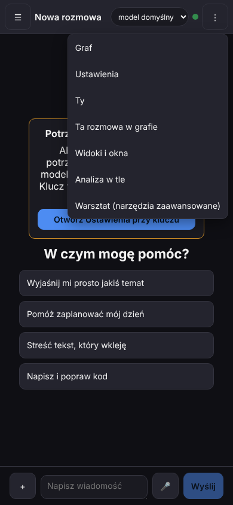

Dotknij **⋮** w prawym górnym rogu. Pozycje: **Graf · Ustawienia · Ty · Ta rozmowa w grafie · Widoki i okna · Analiza w tle ·
Warsztat (narzędzia zaawansowane)**; na Androidzie dochodzi **Połączenie**. Nie ma „Pamięci” ani „Wiedzy” — zgodnie z Twoją
uwagą, że to mylące: pamięć to graf widziany od węzła **Ty**, a wiedza to warstwa dowodów w grafie. Dawne panele nie zniknęły —
są w **Warsztacie**. Menu „+” przy polu wiadomości (P33) zostało bez zmian.

## 2. Graf — korzeń: wiersze z jądra, licznik albo „nieznane (powód)”

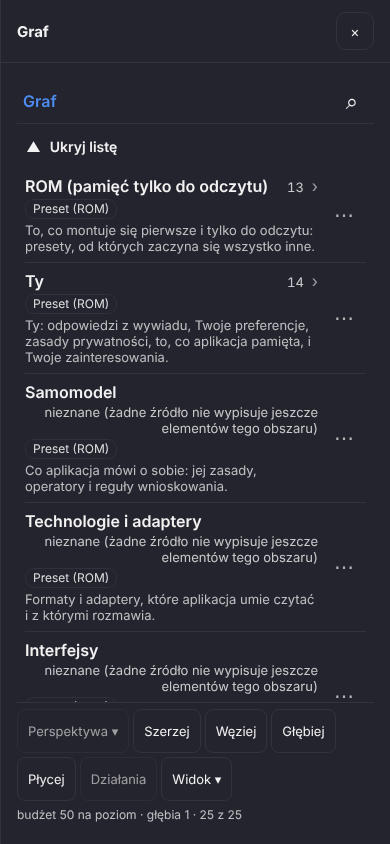

**⋮ › Graf** otwiera nawigator. Każdy wiersz to obszar, który odpowiada jądro (`graph.navigate`) — nic nie jest wpisane w kodzie.
W wierszu: nazwa, **licznik** (ROM 13, Ty 14) albo uczciwe **„nieznane (żadne źródło nie wypisuje jeszcze elementów tego
obszaru)”** — nigdy „0”, gdy aplikacja po prostu nie umie policzyć; **chip pochodzenia** („Preset (ROM)”); jedno zdanie
**po co**. Na dole pasek: **Perspektywa ▾ · Szerzej · Węziej · Głębiej · Płycej · Działania · Widok ▾** (nad paskiem gestów
Androida — `safe-area-inset-bottom`). Szerzej/Węziej podwaja/dzieli budżet wierszy na poziom (zwinięte wiersze są wymienione,
nie ukryte), Głębiej/Płycej zmienia głębokość. Lupa w wierszu ścieżki szuka na bieżącym poziomie.

## 3. ROM — 13 pozycji po polsku, ze stanem

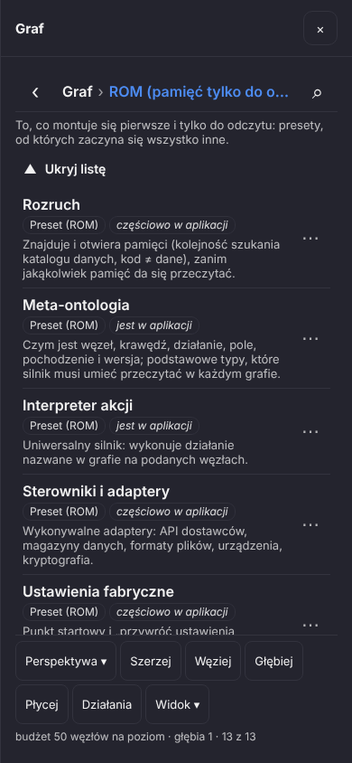

Dotknij **ROM (pamięć tylko do odczytu)**. Ścieżka u góry: **Graf › ROM…** (dotknięcie członu cofa, **‹** cofa o jeden).
Pod ścieżką jedno zdanie, po co jest ten obszar. 13 pozycji (Rozruch, Meta-ontologia, Interpreter akcji, Sterowniki i
adaptery, Ustawienia fabryczne, …) — każda z chipem **Preset (ROM)** i stanem **jest / częściowo / planowane** oraz zdaniem,
co robi. **⋯** przy wierszu albo dotknięcie liścia otwiera **kartę węzła** pod listą: warstwy, wartość, po co, „Skąd jest
wartość”, „Powiązania”, „Co możesz zrobić” (działania jądra słowami; te bez wykonawcy mają chip „planowane”).

## 4. Karta ustawienia — wartość, po co, co zmienia, skąd

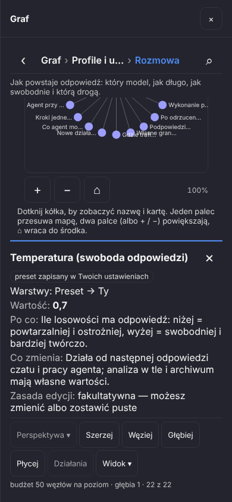

Graf › Profile i ustawienia › Rozmowa › **Temperatura (swoboda odpowiedzi)**: chip „preset zapisany w Twoich ustawieniach”,
**Warstwy: Preset → Ty**, **Wartość: 0,7**, **Po co**, **Co zmienia** (od następnej odpowiedzi; analiza w tle i archiwum mają
własne wartości), **Zasada edycji** (fakultatywna — możesz zmienić albo zostawić puste), **Czyta to** (przepływy, które
czytają pole).

## 5. Zmień → „Dla kogo?” → cały łańcuch dziedziczenia

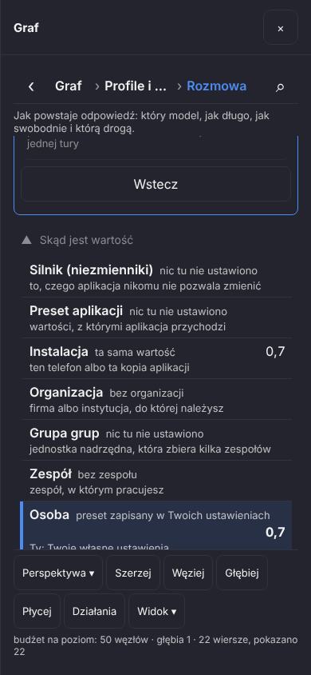

**Zmień** otwiera edytor wg typu pola (liczba, tekst, przełącznik). Potem **„Dla kogo?”**: poziomy, które pole dopuszcza
(dla Temperatury: Ty i ta rozmowa), a **„więcej poziomów”** pokazuje cały łańcuch — z powodem, gdy na poziom nie da się
dziś zapisać (np. „bez projektu”). Zapis dla rozmowy pyta o potwierdzenie (reguła jądra), zapis dla Ciebie idzie od razu.
**„Skąd jest wartość”** wylicza każdy poziom: Silnik (niezmienniki) → Preset aplikacji → Instalacja (przesłonięte, 0.7) →
Organizacja (bez organizacji) → Grupa grup → Zespół → **Osoba — daje wartość (0,7)** (podświetlona) → Rola w kontekście →
Projekt (gałąź) → rozmowa → tura. **„Zdejmij wartość: Ta rozmowa (0,3) — wróci: Osoba (0,7)”** wyłącza regułę rozmowy
(zostaje w historii, nic nie jest kasowane).

## 6. Mapa — te same węzły, dotknięcie = nazwa i karta

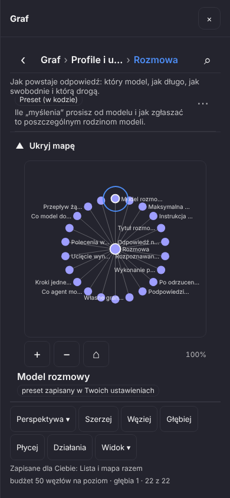

Pod listą jest **mapa** tego samego poziomu (rysowana silnikiem widoków, układ sektorowy: ognisko w środku, dzieci wokół).
Dotknij kółka — pod mapą pojawia się pełna nazwa i chip, a niżej ta sama karta co z listy; **Wejdź ›** schodzi poziom niżej.
**+ / −** i gest dwoma palcami powiększają, **⌂** wraca do środka. Każde kółko ma cel dotyku 44 px. Prostokąt mapy jest
zgłaszany powłoce Androida (`LoomBridge.setGestureExclusion`), żeby przesuwanie mapy nie było brane za gest „wstecz”.
**Widok ▾** przełącza Lista / Mapa / Razem — wybór zapisuje się jako Twoje ustawienie `navigator_layout`
(„Zapisane dla Ciebie: Lista i mapa razem”). Lista i mapa zwijają się osobno („Ukryj listę”, „Ukryj mapę”), nic nie znika.

## 7. Ustawienia — osiem grup po ludzku

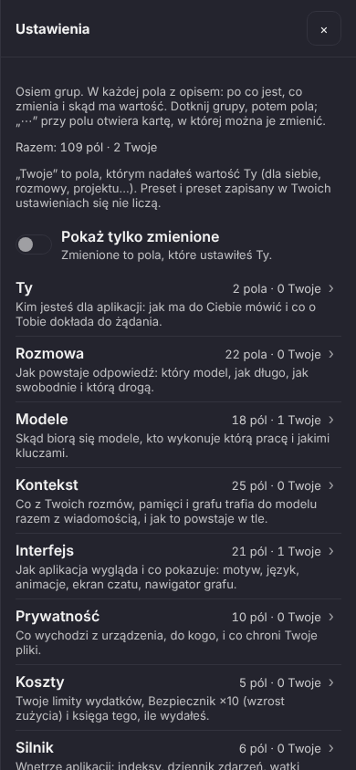

**⋮ › Ustawienia**: osiem grup z jądra (`settings.resolved`), w kolejności danych: **Ty · Rozmowa · Modele · Kontekst ·
Interfejs · Prywatność · Koszty · Silnik**, każda z „**N pól · M Twoje**” i zdaniem, co w niej jest. Dziś: **109 pól**
(liczba z packa `settings_fields.pack`, test sumuje grupy przeciw niej). „Twoje” to pola, którym nadałeś wartość Ty
(dla siebie, rozmowy, projektu) — preset i preset zapisany w Twoich ustawieniach się nie liczą. Przełącznik **Pokaż tylko
zmienione** zostawia same Twoje pola.

## 8. Grupa — pola z opisem i pochodzeniem

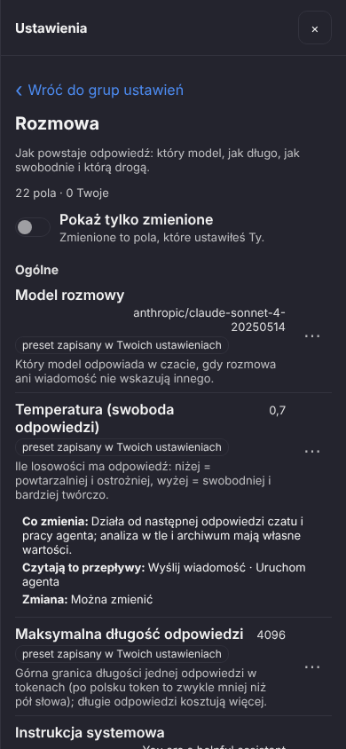

Dotknij grupy (np. **Rozmowa**): „**‹ Wróć do grup ustawień**”, podgrupy (Ogólne, …), każde pole z **polską nazwą**,
**wartością słowami** (0,7; 4096; „włączone”), **chipem pochodzenia** jądra i zdaniem **po co**. Dotknięcie pola rozwija
**Co zmienia**, **Czytają to przepływy**, **Zmiana**; **⋯** otwiera tę samą kartę co w grafie (zapis przeładowuje liczniki).
Pole bez czytelnika w kodzie ma chip **planowane** i zdanie, dlaczego (z danych) — żadne pole nie jest ukryte.

## 9. Modele › Role — kto wykonuje którą pracę

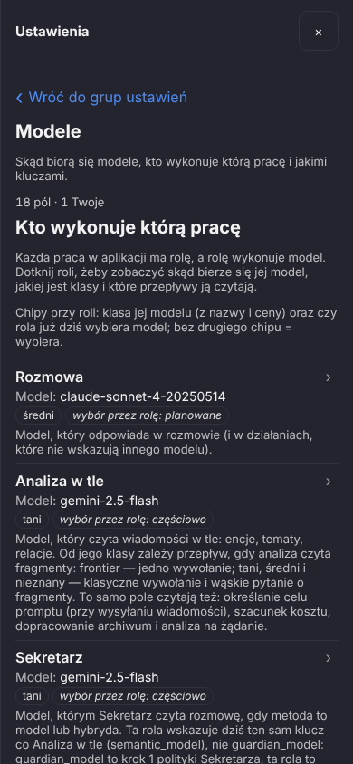

Na górze grupy **Modele** stoi tabela ról z jądra (`roles.resolved`): Rozmowa, Analiza w tle, Sekretarz, Rozpoznanie
polecenia, Obraz, Głos, Osadzenia, Mowa→tekst, Tekst ze zdjęcia, Model dla działania, Formaty plików — każda z **modelem
słowami**, **chipem klasy** (tani / średni / frontier / brak modelu) i stanem (jest / częściowo / planowane) oraz zdaniem, co ta rola robi.

## 10. Karta roli — odpowiedź na „dlaczego jest do wyboru model do analizy, jak są różne flowy”

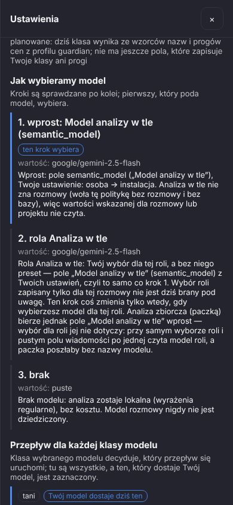

Dotknij **Analiza w tle**. Karta mówi **z danych**: **Po co**, **Dziś** (które prace naprawdę wybierają model przez tę rolę),
**Dlaczego tak jest**; **Model** i **Klasa** z powodem słowo w słowo z jądra („tani, bo nazwa zawiera „mini” …”); **Jak
wybieramy model** — łańcuch polityki krok po kroku (1. wprost: pole „Model analizy w tle”; 2. rola; 3. brak — analiza
lokalna, bez kosztu), z chipem **„ten krok wybiera”** przy tym, który zadecydował; **Przepływ dla każdej klasy modelu** —
tani/średni/nieznany = „Klasyczne wywołanie i wąskie pytanie”, frontier = „Jedno wywołanie: cała rozmowa naraz”, oba z chipem
**kalibracja** tam, gdzie dane tak mówią, a klasa Twojego modelu jest zaznaczona.

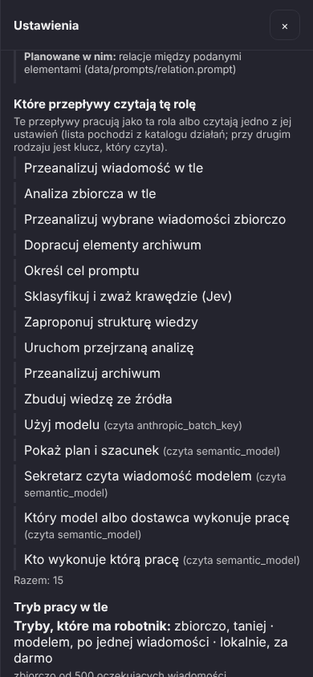

**Które przepływy czytają tę rolę** — **wszystkie**, które pracują jako ta rola albo czytają jej ustawienie
(lista z katalogu działań, dziś 15: Przeanalizuj wiadomość w tle, Analiza zbiorcza w tle, Dopracuj elementy archiwum,
Określ cel promptu, … „Kto wykonuje którą pracę (czyta semantic_model)”). To jest odpowiedź na Twoje pytanie: jedno pole
czyta kilkanaście prac, a **klasa wybranego modelu decyduje, który przepływ ruszy**. Niżej **Tryb pracy w tle** (zbiorczo /
taniej / modelem / lokalnie, z progiem 500 oczekujących) i **koszt** albo powód „nieznana”.

## 11. Silnik › Wszystkie pola — nic nie zniknęło

W grupie **Silnik** na dole jest zwijane **„Pokaż Wszystkie pola”**: dawny ekran ustawień w całości (tabela pól pod nazwami
technicznymi, połączenie, modele, klucze, JSON). Prośba o wpisanie klucza (karta na starcie, podpowiedzi w czacie) otwiera
Ustawienia od razu tutaj.

## 12. Wstecz

Przycisk **wstecz** (Androida, przeglądarki, Escape na komputerze) zamyka **jedną warstwę na raz**, od góry: kartę →
krok ścieżki (Rozmowa → Profile i ustawienia → Graf) → panel; w Ustawieniach: kartę roli → grupę → panel. Na dole stosu
oddaje decyzję powłoce (`window.__loomBack()` zwraca `false` — tam Android pyta, czy wyjść; to pozycja M1-A0).

## Czego jeszcze NIE ma (i dlaczego)

- **Perspektywa ▾** i **Działania** na pasku mówią „planowane — …” po dotknięciu. Perspektywa potrzebuje składania
  perspektyw (sektory / obok siebie) i rendererów z `view_renderers`; Działania = `actions.for` z pola ogniska. Są na
  pasku już teraz, żeby pasek nie zmieniał kształtu między paczkami.
- **Przełącznik „Ustawiam dla: mnie / tej rozmowy / projektu…”** nad listą pól — dziś poziom wybierasz w karcie przy
  każdej zmianie („Dla kogo?”). **Chip „Propozycja modelu”** — jądro mówi wprost: „Dziś żadne pole nie ma propozycji
  strażnika …” (brak mapowania hipotezy na klucz w `guardian.pack`).
- **„Zdejmij wartość: Osoba”** jest wyłączone z powodem: jądro nie ma dziś akcji, która usuwa klucz z Twoich ustawień
  (`settings.unset`, pozycja M1-K1); zdjęcie warstwy rozmowy/projektu działa (reguła zostaje wyłączona, nie skasowana).
- **Przepływ zmieniający się na żywo** przy wpisywaniu modelu roli i **„przypisz klasę ręcznie / zmień progi”** — chipy
  „planowane” z powodem (klasa wynika ze wzorców nazw i progów cen; nie ma jeszcze pola, które zapisuje Twoje klasy).
  Zmiana modelu roli = ta sama karta pola co w grafie. Bez wybranego modelu karta roli mówi, że przepływu jeszcze nie ma.
- **Obszary „nieznane (powód)”** w korzeniu grafu (Samomodel, Technologie i adaptery, Interfejsy, …): żadne źródło
  nie wypisuje jeszcze ich elementów — licznik pojawi się razem ze źródłem, nie wcześniej. Na mapie etykiety są skracane
  do 12 znaków (cała nazwa pod mapą po dotknięciu).
- **Nie na emulatorze Androida.** Powłoka (wstecz przez `OnBackPressedDispatcher`, `adjustResize`, prostokąty gestów,
  pytanie o wyjście) i przebieg `android-smoke` to M1-A0 (sesja S2). Kroki dla sterownika są w bloku `gate0` w
  `docs/reports/M1_W0_TESTIDS.md`.
- Niektóre zdania **„Dlaczego tak jest”** na karcie roli i **powody „planowane”** cytują nazwy plików i akcji
  (`actions.pack`, `settings.set`) — to słowa z danych jądra, pokazane uczciwie; przepisanie ich na prostsze bez utraty
  treści to osobna praca nad danymi, nie nad ekranem.
- Chip **„planowane”** w wierszu roli **Rozmowa** nie znaczy, że czat nie działa: znaczy, że łańcuch polityki tej roli
  opisuje wybór, którego dziś nie czyta żaden wykonawca (czat czyta pole „Model rozmowy” wprost). Karta roli mówi to w „Dziś”.

## Co sprawdzają testy (fakty z tego przebiegu)

- `npm run test:m1-navigator` (`e2e/m1-navigator-native.mjs`, 11 kroków): korzeń = odpowiedź jądra, ROM 13 wierszy po
  polsku ze stanem, szukanie, Szerzej/Węziej/Głębiej/Płycej, karta ROM i karta Temperatury z całym łańcuchem, Zmień → Dla kogo?
  → zapis dla rozmowy (potwierdzenie) i dla Ciebie, Zdejmij wartość, mapa (te same węzły, dotknięcie, +/−/pinch, prostokąt dla
  powłoki, Widok ▾ zapisuje), Wstecz po kolei. `npm run test:m1-settings` (`e2e/m1-settings-native.mjs`, 9 kroków): menu =
  wpisy `layouts.json` bez Pamięci/Wiedzy, 8 grup w kolejności danych z licznikami zsumowanymi przeciw jądru i packowi,
  Rozmowa › Temperatura z chipem jądra i przepływami, Pokaż tylko zmienione, pole planowane z powodem, tabela ról = `roles.resolved`,
  karta Analizy w tle (łańcuch słowo w słowo, klasa z powodem, przepływ każdej klasy, każdy czytelnik), Wstecz, Silnik › Wszystkie pola.
- W każdym kroku: **brak poziomego przewijania** (`scrollWidth ≤ 390`), **każdy przycisk ≥ 44 px** (dawny ekran pod
  Wszystkie pola jest wyłączony ze sprawdzenia — ma 35–40 px i nie był ruszany), **żaden id słowa na ekranie** (brak słowa
  w katalogu pokazałby `card.xxx`, nigdy cichy angielski).
- Zrzuty: 12 plików PNG 390×844 (widok, nie cała strona; każdy < 110 KB) w `docs/reports/M1_CHECKPOINT_0/`, zapisane przez
  te testy z `M1_SHOTS_DIR=docs/reports/M1_CHECKPOINT_0`.
- Poprawki po obejrzeniu zrzutów (P7): Graf otwierał się **przewinięty do mapy** (ostatni wiersz na górze) — zwijany blok
  przewijał się do siebie przy pierwszym rysowaniu; teraz robi to tylko po dotknięciu „Pokaż …”. Zrzut menu ⋮ łapał animację
  w połowie (menu półprzezroczyste nad kartą klucza) — zrzuty czekają na koniec animacji.
