# M1 — Brama 1: co wysłaliśmy do modelu i jak to zmienić (2026-10-22, gałąź `claude/m1-w0`; odświeżone po poprawkach K1c-1 … K1c-3b)

Twoje słowa o kontekście dla modelu (2026-10-16): „Kontekst selektor ma działać inteligentnie według ustawień, pewnie różnie w
zależności od okoliczności, dobierając kontekst z grafu do prompta jako parametr przyjmując głębokość i szerokość. znaczy
modyfikatory względem domyślnych, wiesz, szersze albo głębszy kontekst na żądanie żeby selektor przygotował.” Żeby takie
„szerzej” i „głębiej” miały sens, trzeba widzieć, co naprawdę poszło do modelu. To jest ta Brama: pod każdą odpowiedzią
widać, co wysłaliśmy, czego nie wysłaliśmy i dlaczego — i można to zmienić na następne zapytanie. Poniżej krok po kroku, co
dziś działa, a na końcu wprost, czego jeszcze nie ma.

Skąd są zrzuty: z **prawdziwej aplikacji** (jądro `loom-server` na pustym katalogu danych) w przeglądarce o rozmiarze
telefonu (390×844, dotyk). Model jest **sztuczny** (mały skrypt, który zawsze odpowiada „Hello from the mock model!”), a
rozmowy w zrzutach są wymyślone na potrzeby testu — wszystkie dane na zrzutach są syntetyczne, nie Twoje. To nie jest jeszcze
emulator Androida. Sześć zrzutów menu i paska zrobił test `m1-context-menu-native.mjs`. Siedem zrzutów arkusza zrobiła kopia testu
`m1-context-sent-native.mjs` z czterema dopisanymi poleceniami zrzutu (linia pod odpowiedzią i trzy kroki „szerzej”) — bez zmiany
tego, co test sprawdza; sam test, nietknięty, też przeszedł. Kopii z dopisanymi zrzutami nie ma w repozytorium.
**Odświeżone 2026-10-22:** po poprawkach K1c (jedna liczba ze wskazaną podstawą, graf „wysłane do modelu”) zrobiłem od nowa tylko te zrzuty,
na których zmienił się tekst — arkusz z pkt 2, 3, 4 i 8 — i dodałem cztery zrzuty grafu (pkt 9). Tym razem zrobił je wprost sam test
`m1-context-sent-native.mjs` (zapisuje je do katalogu z `M1_SHOTS_DIR`), bez żadnej kopii.
**Odświeżone jeszcze raz (K1c-4, 2026-10-22):** po zamianie angielskich „po co” na zwykłe polskie słowa zrobiłem od nowa zrzuty z pkt 8 i pkt 9
(`m1-context-sheet-missing`, `m1-sent-graph`, `m1-sent-graph-left-out`, `m1-sent-graph-notes`, `m1-sent-card`) i dodałem jeden nowy w pkt 2
(`m1-context-sheet-memory-why`); reszta zrzutów nie zmieniła tekstu i została. Liczby z różnych
przebiegów mogą się trochę różnić (na przykład 98 i 123 tok. w pkt 1 są z tego samego przebiegu co pkt 2). Pliki są w
`docs/reports/M1_CHECKPOINT_1/`.
Liczby na ekranie (tokeny, pozycje) pochodzą z odpowiedzi aplikacji, nie są wpisane w kodzie; „tok.” to tokeny, czyli kawałki
tekstu, którymi model liczy długość zapytania (to szacunek).

## 1. Pod każdą odpowiedzią: linia „Kontekst: … — zobacz”

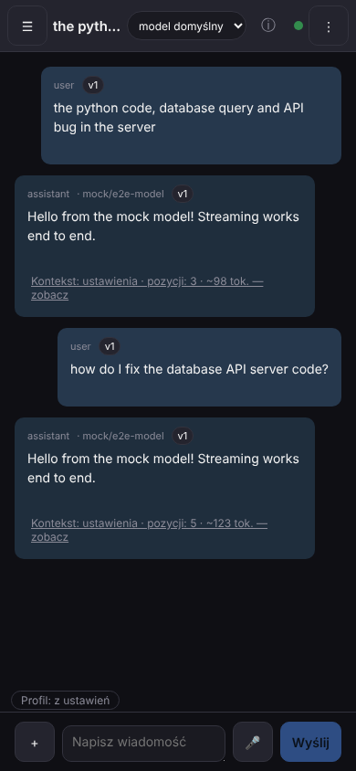

To jedna linia pod odpowiedzią modelu, która mówi, z czym to zapytanie poszło. Widać ją pod obiema odpowiedziami:
**„Kontekst: ustawienia · pozycji: 3 · ~98 tok. — zobacz”** i **„Kontekst: ustawienia · pozycji: 5 · ~123 tok. — zobacz”**.
Na miejscu profilu stoi „ustawienia”, gdy żaden profil nie jest wybrany; „pozycji” to liczba kawałków, z których złożono
zapytanie. Pod spodem, nad polem wiadomości, jest pasek „Profil: z ustawień” (pkt 6).

**Spróbuj:** wyślij wiadomość i dotknij „zobacz” pod odpowiedzią — otwiera się arkusz z pkt 2. Ten sam arkusz otwiera wpis
„Co wysłaliśmy” w menu przy wiadomości (sprawdza to test).

## 2. Arkusz „Co wysłaliśmy”

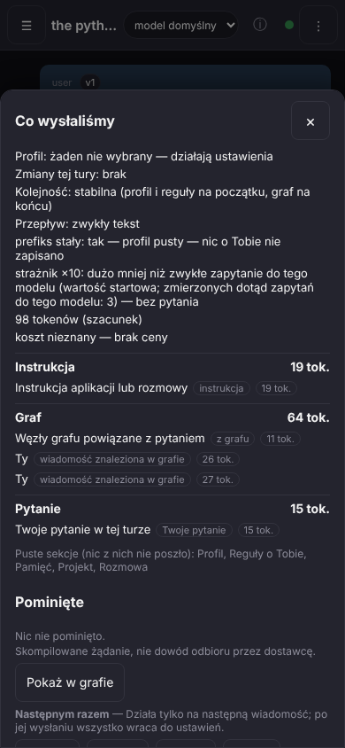

To szuflada, która pokazuje zapytanie tak, jak je złożyliśmy dla modelu. Na górze: profil, zmiany tej tury, kolejność i przepływ
słowami („Kolejność: stabilna (profil i reguły na początku, graf na końcu)”, „Przepływ: zwykły tekst”), czy początek
zapytania jest za każdym razem taki sam („prefiks stały: tak”), **strażnik ×10** („dużo mniej niż zwykłe zapytanie do tego modelu (wartość startowa; zmierzonych dotąd zapytań do tego modelu: 3) — bez pytania”;
po kilku zapytaniach liczba z ×, zawsze z nazwaną podstawą, np. „1.4× zwykłego zapytania do tego modelu (średnia z ostatnich zapytań do tego modelu
(liczba zapytań: 7)) — bez pytania”), suma tokenów
(„98 tokenów (szacunek)”) i koszt: **„koszt nieznany — brak ceny”** (a nie „0”, bo ceny po prostu nie znamy). Niżej **sekcje w kolejności, w jakiej
poszły**, każda z liczbą tokenów i z chipem „skąd” (Instrukcja 19 tok., Graf 64 tok., Pytanie 15 tok.; to pierwsza wiadomość w rozmowie, więc sekcja Rozmowa jest jeszcze pusta),
a pod nimi „Puste sekcje (nic z nich nie poszło)”. Potem lista **„Pominięte”** z powodem przy każdej pozycji (na tym zrzucie:
„Nic nie pominięto.”; z powodem — na zrzucie w pkt 4) i zdanie: **„Skompilowane żądanie, nie dowód odbioru przez dostawcę.”**
To znaczy: arkusz pokazuje, co aplikacja złożyła i wysłała, a nie potwierdzenie, że dostawca to dostał.
Przycisk „Pokaż w grafie” jest **włączony** i otwiera graf tego zapytania (pkt 9); pod odpowiedzią bez zapisu zostaje wyłączony i mówi dlaczego (pkt 8).

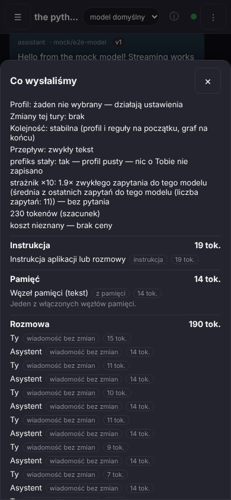

Pozycje, których nazwa sama nie mówi, po co poszły, dostają pod spodem **powód zwykłymi słowami**. Na zrzucie w sekcji Pamięć: „Węzeł pamięci (tekst)”
(typ węzła jest słowem, nie surowym „text” z jądra), chip „z pamięci”, tokeny i powód **„Jeden z włączonych węzłów pamięci.”** Pozycje o nazwie, która już mówi, co to jest
(„Instrukcja aplikacji lub rozmowy”, „Twoje pytanie w tej turze”, wiadomości rozmowy), nie powtarzają powodu w arkuszu — mają go w grafie (pkt 9).

**Spróbuj:** otwórz arkusz pod dowolną odpowiedzią i przewiń do końca; na dole są przyciski „Następnym razem” (pkt 3) i „Zmień profil”.

## 3. „Szerzej” — tylko na jedno zapytanie

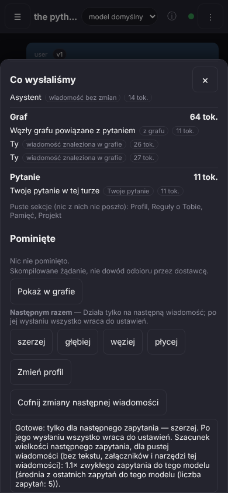

Szerzej, głębiej, węziej i płycej działają **tylko na następne zapytanie**; potem wszystko wraca do ustawień. Po dotknięciu
„szerzej” w arkuszu aplikacja odpowiada: **„Gotowe: tylko dla następnego zapytania — szerzej. Po jego wysłaniu wszystko wraca do
ustawień. Szacunek wielkości następnego zapytania, dla pustej wiadomości (bez tekstu, załączników i narzędzi tej wiadomości): 1.1× zwykłego zapytania do tego
modelu (średnia z ostatnich zapytań do tego modelu (liczba zapytań: 5)).”** i pojawia się przycisk „Cofnij zmiany następnej wiadomości”.
Szacunek mówi więc, dla jakiej wiadomości jest policzony i względem czego. Gdy w menu + › Kontekst jest już wpisany tekst, mówi: „… z wpisanym tekstem,
bez załączników: 2× zwykłego zapytania do tego modelu (średnia z ostatnich zapytań do tego modelu (liczba zapytań: 7))” — a strażnik po wysłaniu tego samego
zapytania mówi „strażnik ×10: 2× zwykłego zapytania do tego modelu (średnia z ostatnich zapytań do tego modelu (liczba zapytań: 7)) — bez pytania”
(oba zdania to wiersze z przebiegu testu menu, bez zrzutu).

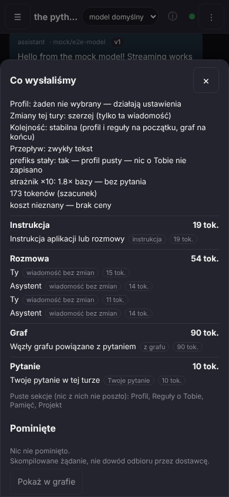

Przed: w arkuszu z pkt 2 sekcja Graf miała **64 tok.** Po wysłaniu następnego pytania sekcja Graf ma **90 tok.**, a nagłówek mówi
**„Zmiany tej tury: szerzej (tylko ta wiadomość)”** i „strażnik ×10: 1.8× zwykłego zapytania do tego modelu (średnia z ostatnich zapytań do tego modelu
(liczba zapytań: 5)) — bez pytania”. W teście podstawa grafu jest
celowo mała (dwa węzły), żeby różnicę było widać.

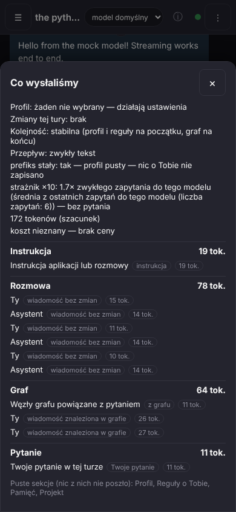

Dla kolejnego pytania, bez żadnej zmiany: Graf znów **64 tok.**, nagłówek **„Zmiany tej tury: brak”**. Porównuj tylko wiersz
Graf — sekcja Rozmowa rośnie z każdą wiadomością (na zrzutach 54 i 78 tok.), więc sumy nie są porównywalne.

**Spróbuj:** w arkuszu dotknij „szerzej” (albo + › Kontekst › Szerzej), wyślij wiadomość, otwórz „zobacz” pod nową odpowiedzią,
potem wyślij następną i porównaj wiersz Graf.

## 4. Profil „Zgodność” — tylko instrukcja, rozmowa i pytanie

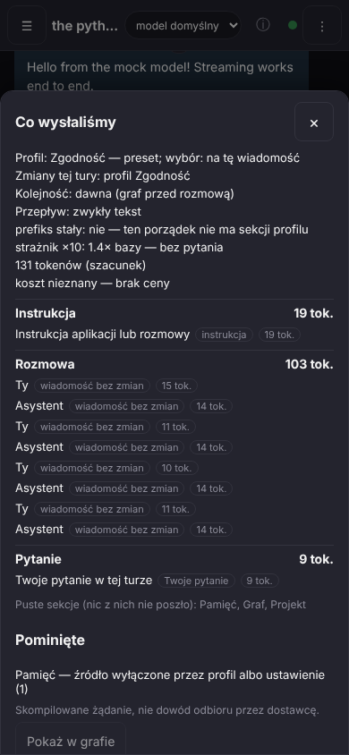

Twoje słowa z 2026-10-14: „i może jeśli tak użytkownik sobie zażyczy w trybie kompatybilności na przykład wybrać jako kontekst
jedynie standardowy system prompt i konwersację całą niemodyfikowaną.” Tak działa profil **Zgodność**: nagłówek mówi
**„Profil: Zgodność — preset; wybór: na tę wiadomość”**, a poszły tylko trzy sekcje — Instrukcja 19 tok., Rozmowa 103 tok.
(wiadomości bez zmian, każda z liczbą tokenów) i Pytanie 9 tok. „Puste sekcje: Pamięć, Graf, Projekt”, a na liście „Pominięte” jest
**„Pamięć — źródło wyłączone przez profil albo ustawienie (1)”**. „Prefiks stały: nie — ten porządek nie ma sekcji profilu”.

**Spróbuj:** w arkuszu dotknij „Zmień profil”, wybierz „Zgodność” (lista profili jest w pkt 5), wyślij wiadomość i otwórz „zobacz”.
Wybór dotyczy jednego zapytania; następne wraca do profilu z ustawień.

## 5. Menu + › Kontekst

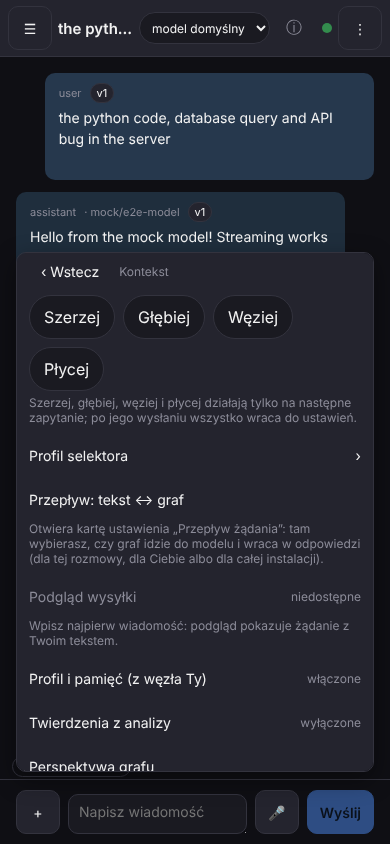

To nowe podmenu przy polu wiadomości, w którym ustawiasz kontekst następnego zapytania. Na górze cztery chipy:
**Szerzej · Głębiej · Węziej · Płycej** (każdy ma co najmniej 44 px), pod nimi zdanie, że działają tylko na następne zapytanie, i drugie: „Kolejne kliknięcia dodają się: dwa razy Szerzej = szerzej ×2.”
Dalej: **Profil selektora** (›), **Przepływ: tekst ↔ graf**, **Podgląd wysyłki** (na zrzucie „niedostępne — wpisz najpierw
wiadomość”) oraz dwa przełączniki, które dostały nowe nazwy: **„Profil i pamięć (z węzła Ty)”** (włączone) i **„Twierdzenia
z analizy”** (wyłączone) — wcześniej nazywały się „Pamięć” i „Wiedza”. **Nic nie zostało usunięte:** test sprawdza, że każda
dawna pozycja menu „+” dalej jest.

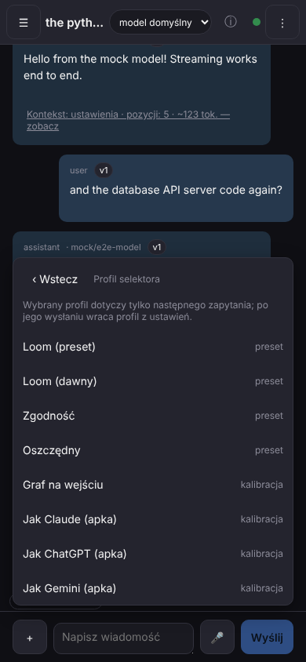

**Profil selektora** to lista: Loom (preset), Loom (dawny), Zgodność, Oszczędny — z napisem „preset” — oraz Graf na wejściu,
Jak Claude (apka), Jak ChatGPT (apka), Jak Gemini (apka) — z napisem **„kalibracja”** (to jeszcze nie są wierne kopie; pkt „NIE ma”).

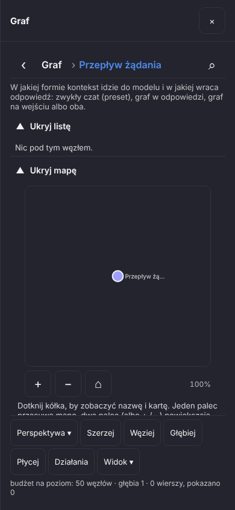

**Przepływ: tekst ↔ graf** otwiera Graf na polu **„Przepływ żądania”** z opisem: „W jakiej formie kontekst idzie do modelu i w jakiej
wraca odpowiedź: zwykły czat (preset), graf w odpowiedzi, graf na wejściu albo oba.” Wstecz wraca do czatu (sprawdza to test).
Na tym zrzucie widać opis i pustą mapę; samej zmiany wartości nie pokazuje.

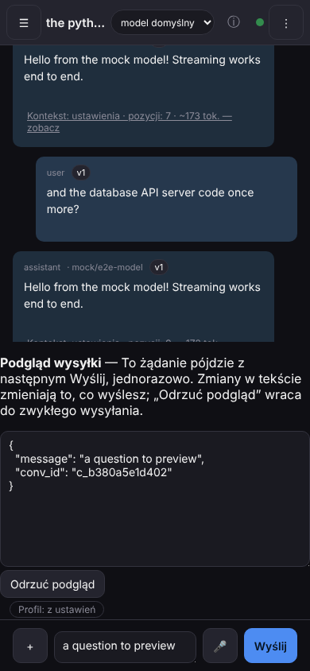

**Podgląd wysyłki** po wpisaniu tekstu pokazuje: „To żądanie pójdzie z następnym Wyślij, jednorazowo. Zmiany w tekście zmieniają
to, co wyślesz; „Odrzuć podgląd” wraca do zwykłego wysyłania.” Dziś w podglądzie widać wiadomość i numer rozmowy, nie cały
złożony kontekst — ten widać dopiero w arkuszu po wysłaniu.

**Spróbuj:** dotknij „+” › Kontekst, wybierz „Szerzej”, wpisz wiadomość, dotknij „Podgląd wysyłki”, a potem „Wyślij”.

## 6. Pasek kontekstu nad polem wiadomości

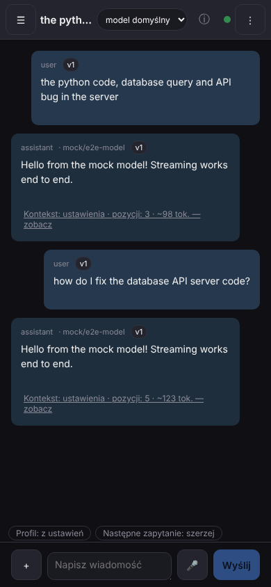

To wąski pasek z chipami tuż nad polem wiadomości, który mówi, z czym pójdzie następne zapytanie, jeszcze przed wysłaniem. Na
zrzucie: **„Profil: z ustawień”** i **„Następne zapytanie: szerzej”**. Po wysłaniu pasek wraca do samego „Profil: z ustawień”;
„Cofnij” też go czyści (sprawdza to test). Pasek zna tylko zmiany zrobione **w tym oknie** — w trybie pełnym mówi to zdaniem:
„Zmiany zrobione w innym oknie widać dopiero w śladzie pod odpowiedzią.” Można go ukryć albo rozwinąć do zdania (ustawienie
paska) — to sprawdza test, zrzutu nie ma.

**Spróbuj:** dotknij „+” › Kontekst › Szerzej i spójrz nad pole wiadomości; potem wyślij wiadomość.

## 7. Chip modelu i skąd się wzięła jego wartość

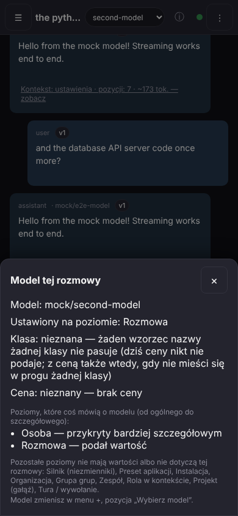

Na górze czatu chip pokazuje **krótką nazwę modelu** („second-model”), a przycisk ⓘ obok otwiera arkusz „Model tej rozmowy”. Arkusz
mówi: **Model**, **Ustawiony na poziomie: Rozmowa**, **Klasa: nieznana** — a powód, który podaje jądro (zdanie po angielsku,
pisane dla inżyniera), czeka w zwiniętym bloku „Szczegóły techniczne” (domyślnie zamkniętym; dokładnie to zdanie, nic nie zniknęło), **Cena: nieznany — brak ceny** oraz poziomy, które coś mówią o modelu (Osoba — „przykryty bardziej szczegółowym”,
Rozmowa — „podał wartość”); pozostałe poziomy są wymienione jednym zdaniem. Na końcu: „Model zmienisz w menu +, pozycja „Wybierz
model”.” Wybieranie modelu to dalej to samo pole wyboru co przedtem (sprawdza to test).

**Spróbuj:** dotknij ⓘ obok nazwy modelu na górze czatu.

## 8. Stara wiadomość: „Brak śladu (zapisane przed M1)”

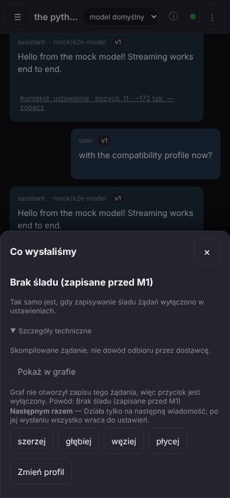

Gdy dla wiadomości nie ma zapisanego śladu, arkusz nie udaje, że coś wie: nagłówek **„Brak śladu (zapisane przed M1)”**, pod nim
zdanie **„Tak samo jest, gdy zapisywanie śladu żądań wyłączono w ustawieniach.”** (zwykłymi słowami; nazw dwóch ustawień, które podaje jądro, w tym zdaniu już nie ma — są tylko
w zwiniętym bloku „Szczegóły techniczne” pod nim, domyślnie zamkniętym) i znów „Skompilowane żądanie, nie dowód odbioru przez dostawcę.” Pod
tym jest przycisk „Pokaż w grafie”, **wyłączony**, z powodem: „Graf nie otworzył zapisu tego żądania, więc przycisk jest wyłączony. Powód: Brak śladu
(zapisane przed M1)”. Przyciski „Następnym razem” i „Zmień profil” zostają. Linia pod taką odpowiedzią też mówi „brak śladu” (sprawdza to test). W teście taką
wiadomość robi wyłączony zapis śladu — prawdziwych wiadomości sprzed M1 w tym przebiegu nie było; arkusz mówi to samo w obu przypadkach.

**Spróbuj:** otwórz „zobacz” pod odpowiedzią zapisaną przy wyłączonym śladzie; na telefonie z Twoimi starymi rozmowami — pod
dowolną starą odpowiedzią.

## 9. „Pokaż w grafie” — to, co poszło do modelu, jako graf

Przycisk „Pokaż w grafie” pod arkuszem był wyłączony nawet wtedy, gdy graf już umiał narysować zapis zapytania. **Przyczyna była po stronie ekranu**, nie grafu:
ekran pytał o wiadomość pod adresem w złej postaci (z niepotrzebnym „m_” w środku), graf odpowiadał „nie ma takiego węzła”, a ekran uznawał to za „graf
nie umie”. Teraz adres jest dobry, przycisk włącza się **tylko wtedy, gdy graf potwierdzi, że ma zapis tego zapytania**, a dotknięcie zamyka arkusz i
otwiera Graf na tym zapytaniu z perspektywą „Wysłane do modelu” (pod paskiem na dole: „Perspektywy: Wysłane do modelu”).

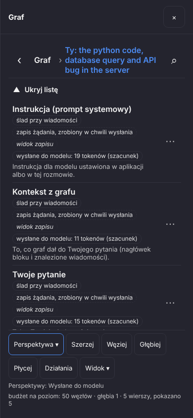

Każdy wiersz to jeden element zapytania. Pod każdym wierszem zapisu stoi **powód, po co poszedł, po polsku** — „Instrukcja dla modelu ustawiona w aplikacji albo w tej rozmowie.”,
„To, co graf dał do Twojego pytania (nagłówek bloku i znalezione wiadomości).”, „Tekst Twojej wiadomości w tej turze.” (K1c-4; wcześniej stały tu angielskie zdania jądra).
Zdanie jądra, zapisane po angielsku w chwili wysyłki, **zostaje w zapisie bez zmian** (zapis to fakt zrobiony raz); ekran mówi to samo własnymi słowami z paczki, a pokazuje zdanie jądra
tylko dla rodzaju pozycji, którego paczka jeszcze nie zna. Wiersze „Instrukcja (prompt systemowy)”, „Kontekst z grafu” i „Twoje pytanie” mają chipy „ślad przy wiadomości”,
„zapis żądania, zrobiony w chwili wysłania”, **„widok zapisu”** (to nie jest zapisany węzeł grafu, tylko widok zapisu zapytania) i **„wysłane do modelu:
19 tokenów (szacunek)”** (u kolejnych: 11 i 15). Tokeny są zawsze szacunkiem z długości tekstu, nie pomiarem po stronie dostawcy. Wiadomości z historii
to prawdziwe wiadomości rozmowy (bez „widoku zapisu”), też z liczbą tokenów.

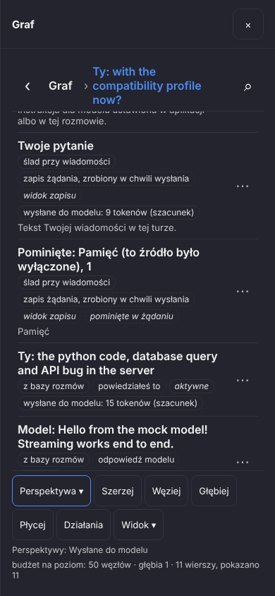

Po wyborze profilu „Zgodność” (pkt 4) **to, czego nie wysłano, też jest wierszem**: „Pominięte: Pamięć (to źródło było wyłączone), 1” z chipem
„pominięte w żądaniu” — a nie zniknęło po cichu.

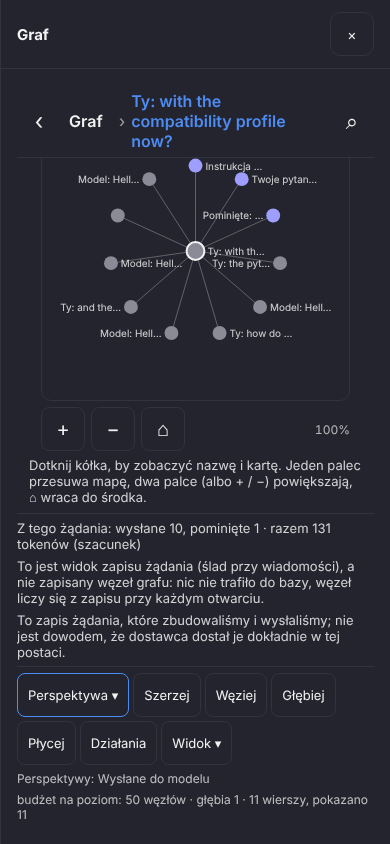

Pod listą i mapą są trzy zdania: **„Z tego żądania: wysłane 10, pominięte 1 · razem 131 tokenów (szacunek)”**, zdanie o tym, że wiersze z „widokiem zapisu”
„nie [są] zapisanym węzłem grafu: nic nie trafiło do bazy, węzeł liczy się z zapisu przy każdym otwarciu” (raz, nie przy każdym wierszu), oraz „To zapis
żądania, które zbudowaliśmy i wysłaliśmy; nie jest dowodem, że dostawca dostał je dokładnie w tej postaci.” Gdy graf jest otwarty na odpowiedzi, a nie na
zapytaniu (z włączoną perspektywą), przechodzi na zapytanie, które ją wywołało, i mówi to jednym zdaniem „z odpowiedzi do jej zapytania” (sprawdza to tylko test jednostkowy,
nie ma zrzutu); gdy zapisu nie ma, pusta lista podaje powód zdaniem jądra zamiast „nic tu nie ma” (też test jednostkowy; w przeglądarce widać go w pkt 8).

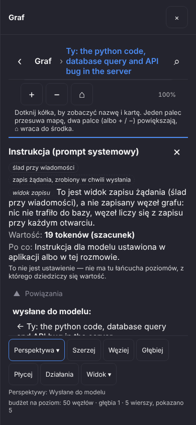

Dotknięcie wiersza z „widokiem zapisu” otwiera jego kartę: chip **„widok zapisu”**, zdanie jądra „To jest widok zapisu żądania (ślad przy wiadomości), a nie
zapisany węzeł grafu …”, **„Wartość: 19 tokenów (szacunek)”**, **„Po co: Instrukcja dla modelu ustawiona w aplikacji albo w tej rozmowie.”** i „Powiązania: wysłane do modelu: ← [zapytanie]”. Wstecz zamyka kartę, drugie Wstecz zamyka
graf i wraca do czatu (sprawdza to test; po nim żadna warstwa nie zostaje).

**Spróbuj:** wyślij kilka wiadomości, otwórz „zobacz” pod ostatnią odpowiedzią, dotknij „Pokaż w grafie”, potem dotknij wiersza „Instrukcja” i „⋯” przy
pominiętym; na końcu Wstecz dwa razy.

## Czego jeszcze NIE ma (i dlaczego)

- **Graf „wysłane do modelu” działa, ale nie wszystko w nim jest jeszcze elementem.** Pamięć i graf są w zapisie wyliczone pozycja po pozycji
  (na zrzutach: nagłówek „Węzły grafu powiązane z pytaniem” i znalezione wiadomości), ale ścieżki „graf w odpowiedzi”, wiedza z analizy i pakiet grafu
  dalej idą jako jedna pozycja zbiorcza. **Zdania „po co” są już po polsku** (K1c-4): ekran bierze słowo z paczki dla każdej pozycji, jakie jądro dziś zapisuje
  (instrukcja, reguły o Tobie, pamięć i jej węzły, graf, pamięć+graf+wiedza, wiedza, wiadomość rozmowy na każdym poziomie, wiadomość z grafu, pakiet grafu,
  fragment profilu, zadanie, prośba o graf, pytanie). Zostają **dwa wyjątki**: (a) zdanie jądra w zapisie jest dalej angielskie (to dane zapisu; nie zmienialiśmy go, widać je tylko
  w odpowiedzi jądra i w razie rodzaju pozycji, którego paczka nie zna), (b) wiersz „pakiet grafu” w nawigatorze ma etykietę, którą nadaje jądro („graph packet” — jądro ma
  słowa tylko dla stałych pozycji), w arkuszu to „Pakiet grafu”. Wiersz „Kontekst z grafu” ma jedno zdanie na dwa przypadki (nagłówek bloku i cały blok), bo jądro daje im tę samą nazwę.
  Zdanie pod „Brak śladu” (pkt 8) nie ma już nazw ustawień po angielsku: mówi „w ustawieniach”, a surowe nazwy są w zwiniętym „Szczegóły techniczne”.
- **Cena jest nieznana.** Zapis w arkuszu nie niesie ceny, więc wszędzie jest „koszt nieznany — brak ceny” (a nie „0”). Model w zrzutach
  jest sztuczny, więc nie ma też zrzutu klasy prawdziwego modelu — jest tylko „klasa: nieznana” z powodem.
- **Pasek kontekstu zna tylko zmiany zrobione w tym oknie.** Jądro nie ma odczytu „co jest zaplanowane na następne zapytanie”
  z innego okna; pasek mówi to zdaniem w trybie pełnym, a pełny obraz jest dopiero w arkuszu pod odpowiedzią.
- **Pytanie ×10 w menu i arkuszu jest podłączone, ale nie widziałem go w przeglądarce.** Strażnik liczy stosunek do bazy (na zrzutach
  1,8× i „bez pytania”); gdy zapytanie przekroczy 10× bazy, ma zapytać Ciebie przed wysłaniem. Tę stronę sprawdziły testy jądra (K1b), ale
  testowi przeglądarkowemu brakuje punktu odniesienia, żeby to pytanie wywołać — więc nie ma go ani na zrzucie, ani w teście przeglądarkowym.
- **Profile „Jak Claude (apka)”, „Jak ChatGPT (apka)”, „Jak Gemini (apka)” i „Graf na wejściu” są presetami kalibracyjnymi**
  (napis „kalibracja”), nie wiernymi kopiami. Etap odtworzenia przepływów tych aplikacji z testami porównawczymi jest później;
  dziś to zwykłe zestawy ustawień oznaczone jako kalibracja; nie twierdzę, że zapytanie wygląda tak jak w aplikacji dostawcy.
- **Nie na emulatorze Androida.** Jeden przebieg `android-smoke` z krokiem „Kontekst” robi sesja S2 (pozycja M1-A1a); czeka na mój
  sygnał, że ta Brama jest na `main`. Kroki dla sterownika dopisano do dokumentu z identyfikatorami elementów.
- **Ty i wywiad (K2)** — ekran „Ty”, pytania wywiadu, karta „Tak zrozumiałem”: to osobna Brama (jądro K2, ekrany W2). Nie ma ich tu.
- **Przeciąganie po długim przytrzymaniu i pozostałe gesty mapy (W3)** — osobna pozycja; w tej Bramie nic się w nich nie zmieniło.
- **Sekcja „Graf” w arkuszu jest teraz wyliczona pozycja po pozycji** (nagłówek „Węzły grafu powiązane z pytaniem” i znalezione wiadomości), więc przy „szerzej”
  przybywa pozycji, nie tylko tokenów: na zrzutach 2 wiadomości z grafu (64 tok.) → 3 (90 tok.) → znów 2 (64 tok.). Powód przy pozycji ma zwykłe polskie
  słowo z paczki; zdanie jądra po angielsku widać już tylko dla rodzaju pozycji, którego paczka nie zna.
- **Szacunek przed wysłaniem a liczba strażnika po wysłaniu — wyjaśnione (K1c-1).** Przyczyna: szacunek liczył się dla **pustej wiadomości**, a graf jest
  dobierany po tekście pytania, więc „szerzej” nie miało czego poszerzyć; wysłane zapytanie z tekstem było większe. Do tego podstawa porównania skakała
  z wartości startowej na średnią i nikt nie mówił, względem czego liczymy. Dziś to jedna liczba z nazwaną podstawą („N× zwykłego zapytania do tego modelu
  (średnia z ostatnich zapytań do tego modelu (liczba zapytań: N))”), a szacunek mówi, dla czego jest policzony — „dla pustej wiadomości” albo „z wpisanym tekstem”;
  z wpisanym tekstem zgadza się ze strażnikiem po wysłaniu (2× i 2×, wiersze testu menu w pkt 3). **Czego nadal nie ma:** arkusz pod odpowiedzią szacuje
  następne zapytanie dla pustej wiadomości (tak mówi zdanie: 1.1× w pkt 3, a po wysłaniu prawdziwego pytania strażnik pokazał 1.8×), więc przed wysłaniem
  pełna liczba jest tylko w menu, gdy wpiszesz tekst; **załączniki i narzędzia wiadomości nie są liczone** (zdanie mówi „bez załączników”).
- **Zmiany „na stałe”** (a nie na jedno zapytanie): jądro umie zapisać regułę rozmowy po zdaniu w rodzaju „… na stałe w tej rozmowie”,
  ale ekrany tej Bramy ustawiają tylko następne zapytanie. Ukrycie linii pod odpowiedzią (zostaje wtedy menu przy wiadomości) i nowe
  linie panelu Kontekst z suwakiem sprawdzają tylko testy jednostkowe — nie ma na nie zrzutu.

## Co sprawdzają testy (w skrócie)

Każdy zrzut w tym raporcie powstał w przebiegu, który przechodzi przez te same ekrany co Ty — na telefonie 390×844, dotykiem,
przeciw prawdziwemu jądru i sztucznemu modelowi. Po poprawkach K1c uruchomiłem trzy przebiegi (`m1-context-sent-native.mjs`, `m1-context-menu-native.mjs`,
`m1-navigator-native.mjs`) **dwa razy z rzędu: wszystkie przeszły** (po poprawkach K1c-4: 10, 12 i 15 kroków za każdym razem, bez błędów; w każdym jest krok „żaden
pokazany ekran nie ma tekstu dla programisty”, który przy każdym zrzucie i otwarciu arkusza sprawdza widoczne napisy i podpisy: surowy klucz albo angielskie zdanie
fail; wiadomości samej osoby i zwinięte „Szczegóły techniczne” są pomijane); skrypty jednostkowe: arkusz 17, pasek 12,
menu „+” 17, skrypt nawigatora (wysłane do modelu) 9 przypadków.

- `loom/web/e2e/m1-context-sent-native.mjs` — linia pod odpowiedzią (profil, liczba pozycji, tokeny; w czacie żadnego surowego JSON-a),
  arkusz (sekcje w kolejności wysyłki, tokeny, lista „Pominięte”, zdanie o dowodzie odbioru, koszt słowami), „Pokaż w grafie”
  **włączony**: dotknięcie otwiera graf na zapytaniu z wysłanymi elementami i ich tokenami, pominięte jako pominięte, wiersze pochodne z oznaczeniem „widok zapisu”,
  karta z zdaniem jądra, Wstecz wraca do czatu; bez zapisu (wyłączony zapis) i przy odmowie grafu przycisk jest wyłączony, z powodem;
  „szerzej” tylko na następne zapytanie (Graf rośnie, potem wraca do bazy), profil Zgodność (tylko Instrukcja,
  Rozmowa i Pytanie), wyłączony zapis śladu (arkusz mówi to słowami), Wstecz zamyka arkusz przed czymkolwiek innym; powód przy elemencie zapisu
  (wiersze grafu, karta, węzeł pamięci w arkuszu) jest słowem z paczki, a nie zdaniem jądra po angielsku (oczekiwanie to słowo z paczki wybrane po kluczu elementu);
- `loom/web/e2e/m1-context-menu-native.mjs` — pasek kontekstu przed wysłaniem, + › Kontekst (nowe pozycje i każda dawna, chipy po
  44 px), „Szerzej” i „Cofnij”, lista profili ze statusami, Podgląd wysyłki (niedostępny przy pustym polu, jednorazowy, można odrzucić),
  Przepływ tekst ↔ graf (karta ustawienia, Wstecz wraca do czatu), chip modelu z arkuszem pochodzenia, pasek ukryty i pełny;
- `npm run test:context-receipt` (stan arkusza i odczyt odpowiedzi jądra), `npm run test:context-strip` (pasek, chip modelu, pochodzenie)
  i `npm run test:composer-menu` (menu „+”: żadna dawna pozycja nie zniknęła).

W obu przebiegach ekrany są sprawdzane tak jak w Bramie 0: nic nie przewija się na boki, a przyciski mają co najmniej 44 px.
Nie uruchamiałem pełnej bramki ani całego `npm run e2e`.

Zrzuty: **18 plików PNG** 390×844 (widok, nie cała strona; każdy < 92 KB) w `docs/reports/M1_CHECKPOINT_1/`, wszystkie wstawione
w tekst (§1–9). Dziennik decyzji i cofnięć tej Bramy jest osobno, w `docs/reports/INDEX.md` (wpis „S1 / M1-K1a, K1b, W1a, W1b”) na gałęzi sesji S1 — na
tej gałęzi dojdzie po scaleniu.
Ten raport mówi tylko, co możesz zrobić na telefonie i czego jeszcze nie ma.

## Poprawki po pierwszym przebiegu emulatora

Czytając teksty z trzech telefonów, znaleźliśmy trzy rzeczy, które brzmiały nieprawdziwie albo po inżyniersku; poprawione, bez zmiany tego, co robi jądro:

- **Stosunek do bazy nie udaje zera.** Strażnik ×10 w arkuszu i szacunek w menu mówiły „0× bazy”, gdy pierwsza krótka wiadomość nowej rozmowy jest bardzo mała albo gdy nie ma w ogóle bazy do porównania. Teraz: brak bazy to „nieznane — brak bazy”, stosunek poniżej 0,1 to „dużo mniej niż zwykle”, od 0,1 w górę jest liczba z ×, np. „1.8× bazy”. Jedna funkcja robi to wszędzie; słowa są w katalogu (po polsku i angielsku).
- **Arkusz modelu mówi krótko, a zdanie jądra jest schowane.** Zamiast długiego angielskiego zdania o wzorcach nazw stoi „Klasa: nieznana”; zdanie jądra jest w zwiniętym bloku „Szczegóły techniczne” (zamknięty, dopóki go nie otworzysz).
- **Nagłówek arkusza nie pokazuje nazw wewnętrznych.** Zamiast „Kolejność: stability / Przepływ: plain” jest „Kolejność: stabilna (profil i reguły na początku, graf na końcu)” i „Przepływ: zwykły tekst”; nazwa bez słowa w katalogu pokazuje się tak, jak jest. Do menu Kontekst doszło jedno zdanie: kolejne kliknięcia dodają się (dwa razy Szerzej = szerzej ×2) — tak ma być.

Przy okazji nowe zrzuty (te same pliki, ten sam sposób): arkusz z góry, arkusz zapytania wysłanego szerzej, arkusz po dotknięciu „szerzej”, arkusz kolejnego zapytania, profil Zgodność, menu Kontekst i pochodzenie modelu. Scenariusz zrzutu „arkusz z góry” jest teraz pierwszą wiadomością rozmowy (stąd 98 tokenów i pusta sekcja Rozmowa).
