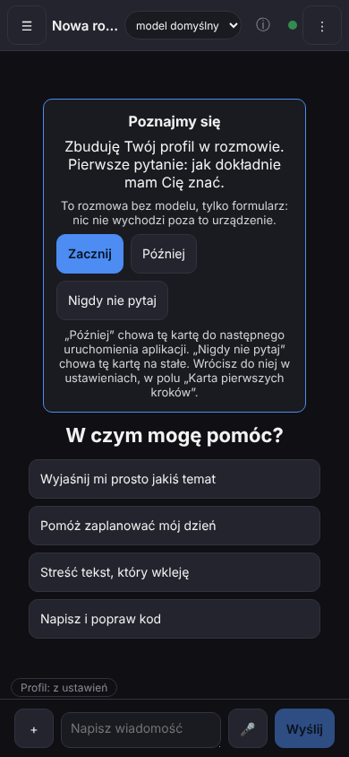
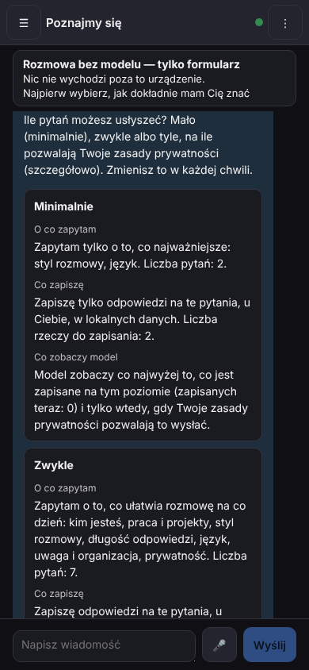
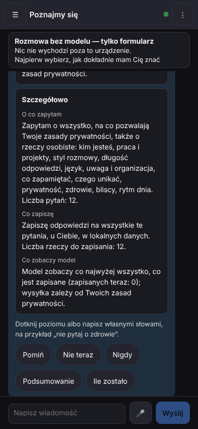
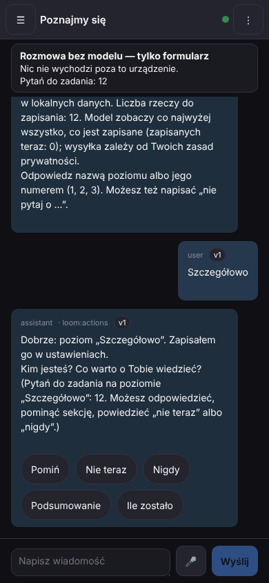
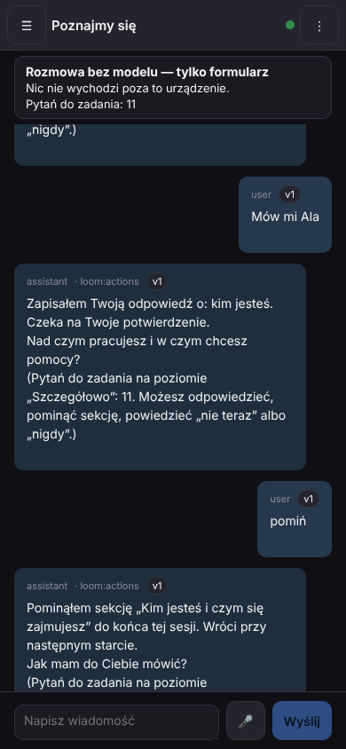
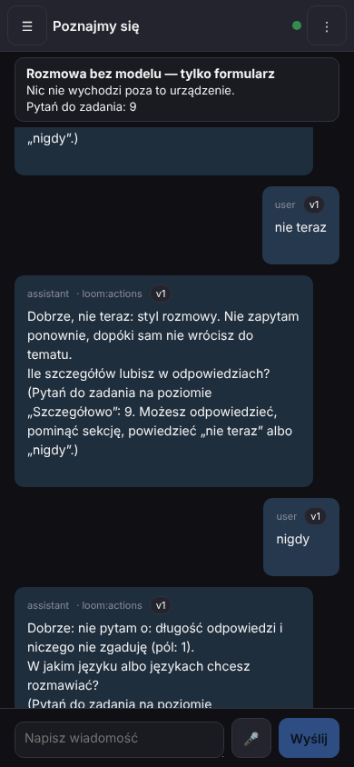
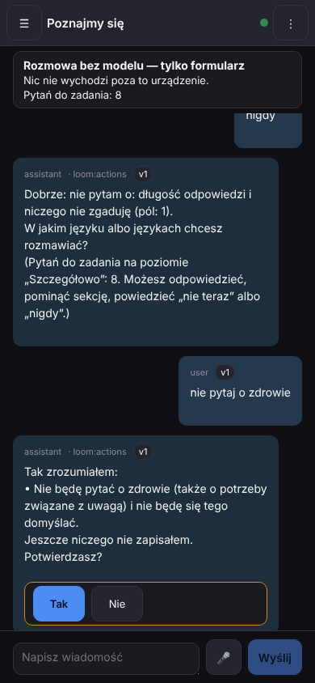
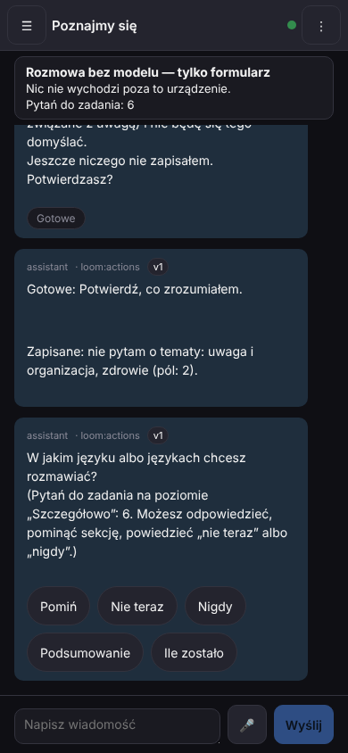

# M1 - Brama 2: Poznajmy się - wywiad w rozmowie (data, gałąź `claude/m1-w0`)

Zdanie z projektu: „Zbuduję Twój profil w rozmowie. Pierwsze pytanie: jak dokładnie mam Cię znać.” Ta
Brama pokazuje, że to już działa w aplikacji: z pustego czatu zaczynasz wywiad, a on toczy się w zwykłym oknie rozmowy — z kartami do
dotknięcia, z możliwością pominięcia i „nigdy” w każdej chwili. Poniżej krok po kroku, co dziś działa, a na końcu wprost, czego jeszcze
nie ma.

Skąd są zrzuty: z **prawdziwej aplikacji** (jądro `loom-server` na pustym katalogu danych) w przeglądarce o rozmiarze telefonu
(390×844, dotyk). Wywiad **nie używa modelu** — to formularz w rozmowie. Obok stoi sztuczny serwer „modelu”, który tylko liczy
żądania; test sprawdza, że w czasie całego wywiadu nie dostał ani jednego (0). Wszystkie odpowiedzi na zrzutach („Mów mi Ala”) są
wymyślone na potrzeby testu — nie są Twoje. To nie jest jeszcze emulator Androida. Zrzuty zrobił sam test
`loom/web/e2e/m1-profile-native.mjs` (zapisuje je do katalogu z `M1_SHOTS_DIR`). Pliki są w `docs/reports/M1_CHECKPOINT_2/`.

## 1. Karta „Poznajmy się” w pustym czacie

Pusty czat (ustawienie „Karta pierwszych kroków” = pokazuj, wywiad jeszcze się nie zaczął) pokazuje kartę: „Poznajmy się — Zbuduję
Twój profil w rozmowie. Pierwsze pytanie: jak dokładnie mam Cię znać.” oraz „To rozmowa bez modelu, tylko formularz: nic nie wychodzi
poza to urządzenie.” Pod spodem są trzy przyciski: **Zacznij**, **Później**, **Nigdy nie pytaj**, i zdanie, co każdy robi:
„Później” chowa kartę do następnego uruchomienia aplikacji, „Nigdy nie pytaj” chowa ją na stałe, a wrócisz do niej w ustawieniach,
w polu „Karta pierwszych kroków”. Powiedziałem „w ustawieniach”, bo przycisk „Poznaj mnie” w menu (ekran „Ty”) jeszcze nie istnieje.

Test sprawdza, że „Później” zapisuje `later` w ustawieniach (nie w pamięci przeglądarki), karta wraca po następnym uruchomieniu
(strona odświeżona: ustawienie samo wraca do „pokazuj”), „Nigdy nie pytaj” zapisuje `never` i po odświeżeniu karty nie ma, a po
ręcznym przywróceniu ustawienia karta jest znowu.

## 2. Pierwsze pytanie: trzy poziomy z podglądem

„Zacznij” otwiera rozmowę „Poznajmy się”. Nad nią stoi linia „Rozmowa bez modelu — tylko formularz / Nic nie wychodzi poza to
urządzenie. / Najpierw wybierz, jak dokładnie mam Cię znać”. Pierwsze pytanie („Ile pytań możesz usłyszeć? …”) to trzy karty
poziomów — **Minimalnie**, **Zwykle**, **Szczegółowo** — a w każdej trzy pola: „O co zapytam”, „Co zapiszę”, „Co zobaczy model”
(na zrzucie np. Minimalnie: „Zapytam tylko o to, co najważniejsze: styl rozmowy, język. Liczba pytań: 2.”). Teksty podglądu są
z odpowiedzi jądra, test porównuje je znak po znaku. Nic nie jest wybrane za Ciebie. Pod kartami jest podpowiedź („Dotknij poziomu
albo napisz własnymi słowami, na przykład „nie pytaj o zdrowie”.”) i szybkie odpowiedzi: **Pomiń**, **Nie teraz**, **Nigdy**,
**Podsumowanie**, **Ile zostało**. W tej rozmowie nie ma wyboru modelu, menu „+” ani paska kontekstu — nic nie idzie do modelu.

## 3. Odpowiadanie, pomijanie, „nigdy”

Dotknięcie karty poziomu to Twoja odpowiedź: w rozmowie pojawia się wiadomość z nazwą poziomu, a asystent zadaje następne pytanie
i pokazuje, ile ich zostało („Pytań do zadania: 12”, potem 11, 8 … — liczba pochodzi z jądra). Pod każdym pytaniem są te same
szybkie odpowiedzi; każda wysyła jedno słowo sterujące jako zwykłą wiadomość.

Na zrzucie: odpowiedź „Mów mi Ala” (zapisana jako czekająca na Twoje potwierdzenie), potem „pomiń” — „Pominąłem sekcję „Kim jesteś
i czym się zajmujesz” do końca tej sesji. Wróci przy następnym starcie.” i od razu następne pytanie.

Dalej „Nie teraz” — „Dobrze, nie teraz: styl rozmowy. Nie zapytam ponownie, dopóki sam nie wrócisz do tematu.” — i „Nigdy” — „Dobrze:
nie pytam o: długość odpowiedzi i niczego nie zgaduję (pól: 1).” Każde z tych słów w rozmowie to dokładnie słowo szybkiej odpowiedzi
(test dotyka każdej i to sprawdza). Pod odpowiedzią, która o nic nie pyta (np. „Ile zostało”), szybkie odpowiedzi to „Dalej”,
„Podsumowanie” i „Ile zostało”.

## 4. „Tak zrozumiałem”

Napisana własnymi słowami uwaga „nie pytaj o zdrowie” nie zapisuje niczego od razu. Asystent odpowiada: „Tak zrozumiałem: • Nie będę
pytać o zdrowie (także o potrzeby związane z uwagą) i nie będę się tego domyślać. Jeszcze niczego nie zapisałem. Potwierdzasz?” —
a pod spodem są dwa przyciski, **Tak** i **Nie**. W pierwszej wersji ten blok pokazywał pola jądra („kind=remark, user_id=local …”,
plan, szacunek); w rozmowie wywiadu pokazuje teraz tylko te dwa przyciski, a zdanie nad nimi mówi, co zrozumiałem. Test sprawdza,
że blok nie ma nic poza „Tak” i „Nie”.

Po „Tak” jądro zapisuje „nie pytam o tematy: uwaga i organizacja, zdrowie (pól: 2)” (test pyta jądro, czy temat zdrowie ma stan
„nigdy”), liczba pytań do zadania maleje (na zrzucie 6), a następne pytanie pojawia się od razu, z szybkimi odpowiedziami.

## Czego jeszcze NIE ma

- **Ekran „Ty”** (podgrafy, stany pól „wiem / nieznane / pominięte / nigdy nie pytaj”, Popraw i Zapomnij na zawsze, jednostki) oraz
  przycisk „Poznaj mnie” w menu — to następna paczka (W2b). Dlatego karta mówi „w ustawieniach”, a nie „menu › Ty”.
- **Wywiad z modelem** — nie ma go; jądro go odrzuca z powodem. Wywiad jest formularzem.
- **Emulator Androida** — wszystko sprawdzone w przeglądarce o rozmiarze telefonu z dotykiem, nie na emulatorze.
- Zaczęty i porzucony wywiad zostawia kartę schowaną (profil już istnieje); wracasz do niego z listy rozmów („Poznajmy się”).
- Tytuł wyniku po „Tak” („Gotowe: Potwierdź, co zrozumiałem.”) to ogólny szablon wyniku akcji z jądra (widać go na zrzucie po „Tak”).

## Co sprawdzają testy

- `loom/web/tests/shell/interview.test.mjs` (11 przypadków): karta wg ustawienia i stanu wywiadu, „Później” do następnego uruchomienia,
  karty poziomów tylko z kompletnych danych (inaczej zwykły tekst), pytanie, które czeka, szybkie odpowiedzi i ich słowa sterujące
  (każde słowo musi być słowem sterującym z `chat_ops.pack`, po polsku i angielsku), czytniki odpowiedzi jądra, zgodność słów pl/en.
- `loom/web/e2e/m1-profile-native.mjs` (390×844, dotyk, prawdziwe `loom-server`, bez modelu): karta w pustym czacie i jej trzy przyciski
  (ustawienie w jądrze, powrót po uruchomieniu), rozmowa wywiadu z linią „bez modelu”, trzy karty poziomów z podglądem jądra, wybór
  poziomu, odpowiedź wpisana, wszystkie szybkie odpowiedzi, propozycja „Tak zrozumiałem” z „Tak”/„Nie”, zapis tematu „nigdy”, Wstecz
  zamyka warstwy po kolei, audyt tekstów (żadnych surowych kluczy ani angielskich zdań na polskim ekranie) na każdym zrzucie i
  **0 żądań do atrapy modelu**.
