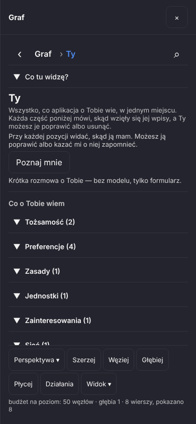
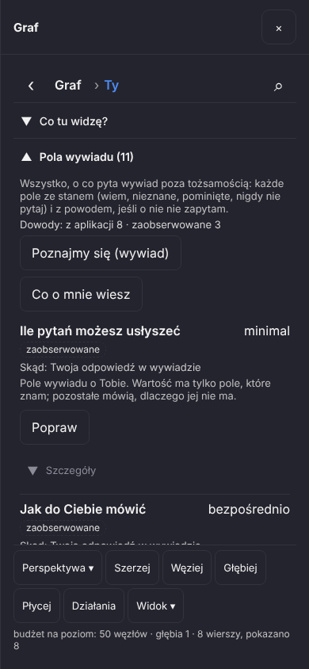
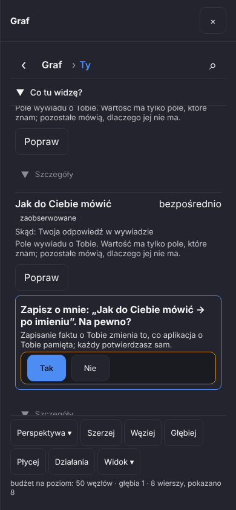
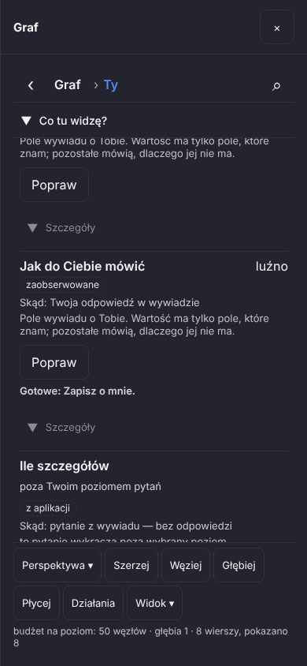
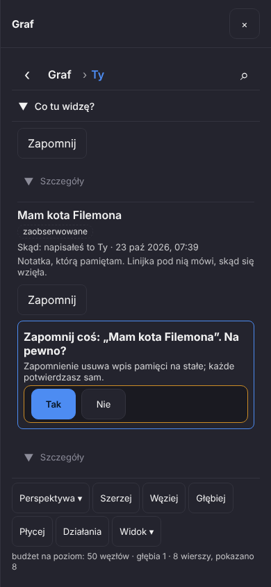
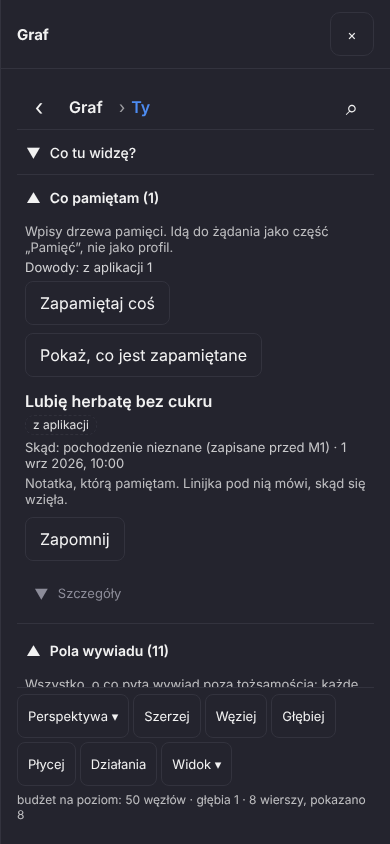
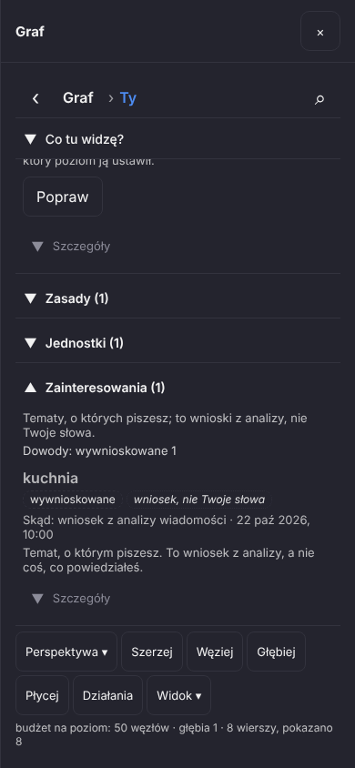
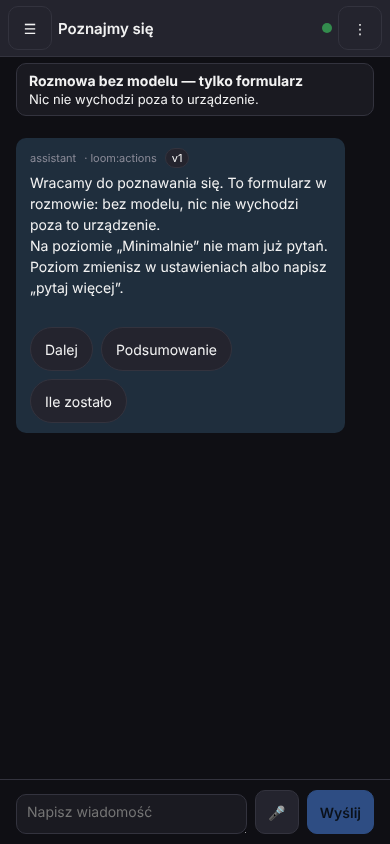

# M1 - Brama 3: Ty - co aplikacja o Tobie wie (data, gałąź `claude/m1-w1`)

Pomysł z wymagań (ON05 — to parafraza Twojego pomysłu z 2026-09-26, nie Twoje dosłowne słowa): osobny widok „co aplikacja o mnie wie” pozwala poprawiać i usuwać
z historią. Ta Brama pokazuje, co z tego działa dziś na ekranie „Ty” (⋮ › Ty): jedna strona z tym, co aplikacja o Tobie trzyma, podzielona na części, z licznikami,
z chipem dowodu i linią „Skąd” przy każdym wpisie, z przyciskami **Popraw** i **Zapomnij** (każdy pyta o zgodę) i z wejściem **Poznaj mnie**. Na końcu
wprost: czego jeszcze nie ma — a jest tego sporo, w tym dwa napisy na zrzutach, które nie powinny tak brzmieć.

Skąd są zrzuty: z **prawdziwej aplikacji** (jądro `loom-server` na pustym katalogu danych) w przeglądarce o rozmiarze telefonu (390×844, dotyk). Osoba z
zrzutów jest **wymyślona na potrzeby testu** („Mam kota Filemona”, „Lubię herbatę bez cukru”, temat „kuchnia” — nic z tego nie jest Twoje). Obok stoi
sztuczny serwer „modelu”, który tylko liczy żądania; test sprawdza, że przez cały przebieg nie dostał ani jednego. To **nie jest jeszcze emulator
Androida**. Zrzuty zrobił sam test `loom/web/e2e/m1-me-native.mjs`; pliki są w `docs/reports/M1_CHECKPOINT_3/`. Wszystkie napisy na ekranie przychodzą z
jądra albo ze słów w paczce `conversation_view.pack` (klucze `me.*`) — strona nie ma własnej listy części ani własnych nazw przycisków.

## 1. Sekcje z licznikami

⋮ › Ty otwiera stronę, na górze z tytułem „Ty” i zdaniem: „Wszystko, co aplikacja o Tobie wie, w jednym miejscu. Każda część poniżej mówi, skąd wzięły się jej
wpisy, a Ty możesz je poprawić albo usunąć.” Niżej jest przycisk **Poznaj mnie** i nagłówek „Co o Tobie wiem” z częściami. Dla tej wymyślonej osoby test
wypisał (linia z przebiegu): **Tożsamość (2) · Preferencje (4) · Zasady (1) · Jednostki (1) · Zainteresowania (1) · Sieć (1) · Co pamiętam (2) · Pola wywiadu (11)**.
Zrzut pokazuje pięć pierwszych nagłówków i ucięty szósty (reszta jest niżej, pod dolnym paskiem).

Części i liczby to odpowiedź jądra (`graph.navigate` na „Ty”), w jego kolejności; test porównuje nagłówek każdej części z etykietą i liczbą z jądra i sprawdza,
że liczba na części to liczba wpisów w środku. Na starcie wszystkie części są zwinięte (to ustawienie startowe, nie reguła); to, co otworzysz, zapamiętuje
ustawienie `me_open_sections`, a test odświeża stronę i sprawdza, że otwarta część wraca otwarta. Pod stroną stoją, zwinięte, „Wszystkie wiersze” (zwykła
lista wierszy węzła) i mapa.

## 2. Jeden wpis: wartość, chip dowodu, skąd to wiem

Otwarta część „Pola wywiadu (11)”: zdanie o tym, co w niej jest, linia „Dowody: z aplikacji 8 · zaobserwowane 3” (ile wpisów jakiej klasy dowodu), dwa
przyciski części („Poznajmy się (wywiad)”, „Co o mnie wiesz”) i pierwszy wpis: **„Ile pytań możesz usłyszeć — minimal”**, chip **„zaobserwowane”**, linia
**„Skąd: Twoja odpowiedź w wywiadzie”**, zdanie o polu, przycisk **Popraw** i zwijane „Szczegóły”. Chip to klasa dowodu słowami (z aplikacji / zaobserwowane /
wyprowadzone / wywnioskowane …), linia „Skąd” to słowa jądra plus czas, gdy jest (zrzut 08: „Skąd: pochodzenie nieznane (zapisane przed M1) · 1 wrz 2026, 10:00”).
Pole, które zamknąłeś słowem „nigdy”, nie ma wartości — pokazuje tylko słowo stanu „nigdy” (krok 3 testu; sprawdza też, że strona nie wypisuje żadnej wartości).

**Dwa napisy z tego zrzutu, które nie są dobre, a których ta paczka nie zmieniała (dane jądra):** „minimal” to angielski identyfikator poziomu, a nie jego nazwa
(„Minimalnie” widać dopiero w rozmowie, zrzut 11); i chip „zaobserwowane” stoi przy Twojej własnej odpowiedzi — jądro nazywa tę klasę `observed`, a słowo na
chipie to jego tłumaczenie. Linia „Skąd” obok mówi prawdę („Twoja odpowiedź w wywiadzie”), ale chip tego nie rozróżnia. Test tekstu (`m1-audit.mjs`) łapie
surowe klucze i angielskie zdania, nie pojedyncze słowa, więc tego nie wykrył.

## 3. Popraw

**Popraw** przy polu otwiera pole do wpisania wartości, zaczyna od obecnej („bezpośrednio”); „Dalej” pyta jądro. Reguły każą zapytać, więc pod wpisem pojawia
się blok z pytaniem: **„Zapisz o mnie: »Jak do Ciebie mówić → po imieniu«. Na pewno?”**, pod nim powód jądra („Zapisanie faktu o Tobie zmienia to, co aplikacja o
Tobie pamięta; każdy potwierdzasz sam.”) i dwa przyciski: **Tak** / **Nie**. W teście „po imieniu” jest wartością próbną: **Nie** daje „Nic nie zmieniłem —
odmówiłeś.” i wartość w jądrze oraz na ekranie zostaje bez zmian. Drugi raz test wpisuje „luźno” i odpowiada **Tak**: wartość zmienia się w jądrze i na ekranie
(zrzut 05: „Jak do Ciebie mówić — luźno”, pod przyciskiem „Gotowe: Zapisz o mnie.”).

Uwaga o tym, co widać na zrzucie 05: po poprawce linia „Skąd” nadal mówi **„Twoja odpowiedź w wywiadzie”** (tak odpowiada jądro po `profile.set`: metoda `interview`, czasu nie
ma — `"time":null`). Fakt, że poprawiłeś ją na ekranie „Ty”, a nie w wywiadzie, nigdzie nie zostaje.

## 4. Zapomnij

Przy notatce z „Co pamiętam” **Zapomnij** pyta tak samo: **„Zapomnij coś: »Mam kota Filemona«. Na pewno?”**, powód: **„Zapomnienie usuwa wpis pamięci na stałe;
każde potwierdzasz sam.”**, przyciski Tak / Nie. Po **Tak** notatka znika, jądro nie ma jej już w liście, a licznik w nagłówku spada: z przebiegu
**„Co pamiętam (2)” → „Co pamiętam (1)”**. Na zrzucie 08 została notatka „Lubię herbatę bez cukru”, napisana, zanim aplikacja zaczęła zapisywać pochodzenie:
chip „z aplikacji”, linia **„Skąd: pochodzenie nieznane (zapisane przed M1) · 1 wrz 2026, 10:00”** — aplikacja nie twierdzi, że to Twoje słowa. Zdanie „zapisane
przed M1” to słowa jądra (dane), nie powinno pokazywać Ci nazwy naszego etapu prac; zostaje do poprawienia w danych.

**Zapomnij usuwa na stałe i nie zostawia na ekranie historii** — tak mówi samo pytanie. „Z historią” z Twojego zdania na tej stronie jeszcze nie ma (patrz niżej).

## 5. Wnioski i preferencje

Wpis, który jest **wnioskiem z analizy**, a nie Twoimi słowami, ma dwa chipy: „wywnioskowane” i „wniosek, nie Twoje słowa”, linię „Skąd: wniosek z analizy
wiadomości · 22 paź 2026, 10:00” i jest narysowany bledziej: test czyta wyliczoną przezroczystość i sprawdza, że wynosi **0,72** (ustawienie startowe;
ustawienie `me_inferred_opacity` je zmienia, 1 = wygląda jak każdy inny wpis), a wpis niebędący wnioskiem ma 1. Ten wygląd to jeden z wielu możliwych sposobów
oznaczenia wniosku, nie jedyny. Przy preferencjach test sprawdza, że wiersz mówi, **kto ją ustawił** („ustawił: …” z nazwą poziomu z jądra), a po dotknięciu
„Szczegóły” pokazuje cały łańcuch poziomów dokładnie tak, jak go zwraca jądro (kolejność i poziomy).

## 6. Poznaj mnie

**Poznaj mnie** (u góry strony) zamyka panel i otwiera rozmowę wywiadu — tę samą co z karty „Poznajmy się”: u góry „Rozmowa bez modelu — tylko formularz / Nic nie
wychodzi poza to urządzenie.” Dla osoby, która wybrała już poziom „Minimalnie”, rozmowa mówi: „Wracamy do poznawania się. … Na poziomie »Minimalnie« nie mam już
pytań. Poziom zmienisz w ustawieniach albo napisz »pytaj więcej«.” z przyciskami Dalej / Podsumowanie / Ile zostało. Po drodze: **Wstecz** zamyka warstwy po
kolei (część z „Wszystkich wierszy” → Ty → panel; gdy panelu już nie ma, Wstecz oddaje obsługę dalej, `__loomBack()` zwraca `false`) — krok 9 testu. (Etykieta „assistant · loom:actions” nad dymkiem jest
po angielsku; to stary napis czatu, nie tej strony.)

## 7. Czego NIE ma

- **Jednostki w ekranie „Ty”.** Jądro daje na wpisie jednostki akcje „Usuń jednostkę” i „Dodaj rozmowę do jednostki” (opis K2c2 w INDEX), a ekran rysuje przyciski z `actions[]` każdego wpisu,
  ale **test nie otwiera części „Jednostki” ani nie dotyka tych przycisków**. Dodawania i usuwania jednostek z tego ekranu nie sprawdzałem — nie twierdzę, że działa. Test dotyka tylko **Popraw** (pole wywiadu), **Zapomnij**
  (notatka) i **Poznaj mnie**. Przyciski części („Zapamiętaj coś”, „Pokaż, co jest zapamiętane”, „Co o mnie wiesz”) są narysowane, ale też niesprawdzone.
- **Wywiad od nowa.** „Poznaj mnie” wznawia rozmowę (zrzut 11: „Wracamy do poznawania się”); nie ma „Poznaj mnie od nowa” — wyczyszczenia i zaczęcia całego profilu.
- **Potwierdzanie zainteresowań.** Wniosek jest oznaczony, ale nie ma przycisku „Potwierdź” ani „Odrzuć”: według opisu jądra (K2c2) katalog akcji takiej akcji nie ma, a wpis zainteresowania ma
  pustą listę akcji; na zrzucie 10 pod wpisem „kuchnia” nie ma żadnego przycisku oprócz „Szczegóły”.
- **Historia zmian.** Ekran nie pokazuje, co było wcześniej (poprzedniej wartości po Popraw, zapomnianej notatki). Według
  przeglądu z 2026-10-16 (`LUKI_2026-10-16.md`) starszy panel „Co aplikacja wie” miał historię wpisów — dziś tego nie sprawdzałem; w nowym ekranie jej nie ma.
- **Pochodzenie po poprawce** zostaje „Twoja odpowiedź w wywiadzie” (patrz 3), a „Zapomnij” nie zostawia po sobie śladu.
- **Części, których nie dodałem:** „Reguły strażnika”, „Urządzenia”, „Wyuczone przez model” (kandydaci profilu). Propozycje modelu z zwykłej rozmowy nie trafiają
  do profilu, więc ekran ich też nie pokaże.
- **Poprawa preferencji na poziomie rozmowy lub jednostki** z tego ekranu — `settings.set` zna tylko pola ustawień; test sprawdza Popraw tylko na polu wywiadu.
- **Android.** Ekran sprawdzony w przeglądarce o rozmiarze telefonu, nie w emulatorze ani na urządzeniu.
- **Dwa napisy z sekcji 2 i „zapisane przed M1”** — do poprawienia w danych jądra (wartość pola wyboru po nazwie, nie po identyfikatorze; słowa pochodzenia bez nazwy etapu),
  oraz decyzja, czy klasa `observed` ma na własnych odpowiedziach nazywać się inaczej.

## 8. Co sprawdzają testy

- **Jednostkowe** (`npm run test:me-view`, 12 przypadków): te same słowa `me.*` po polsku i angielsku, żadne puste; części w kolejności jądra z licznikami i
  mieszanką dowodów; chip dla każdej klasy dowodu (nieznana klasa mówi „rodzaj dowodu nieznany”, nigdy surowy identyfikator); linia „Skąd” bez słów jądra
  mówi „brak zapisu”; pole bez wartości pokazuje stan, nie wartość; przyciski to `actions[]` wpisu, akcja jeszcze nie wdrożona jest oznaczona i nie jest
  przyciskiem; argumenty wpisywane przez Ciebie pochodzą ze słów; przebieg pytania (pytanie / błąd / zrobione); wygląd wniosku i zapamiętane części;
  szczegóły; **każda kombinacja klasy dowodu i kształtu wartości daje wiersz ze słowami** (przestrzeń możliwości, nie tylko przykłady); łańcuch preferencji.
  Do tego `test:testids-doc` (identyfikatory ekranu opisane), `navigator-state`, `node-card-state`, `label-guard`, `interview`.
- **Przeglądarkowe, na prawdziwym `loom-server`** (`npm run test:m1-me`, 390×844, dotyk, 10 kroków): sekcje, otwarcie i zapamiętanie, pole „nigdy”, Popraw → Nie,
  Popraw → Tak, Zapomnij, preferencja i łańcuch, wniosek, Poznaj mnie, Wstecz; każdy przycisk co najmniej 44×44 px, brak poziomego przewijania, **0 żądań do
  modelu**, brak błędów strony, test tekstu bez uwag. Jednostkowe i ten test dopisałem do kroków CI (`.github/workflows/loom.yml`) obok sąsiadów; CI jeszcze ich
  nie uruchomiło.
- **Sąsiedzi nadal przechodzą:** `m1-navigator` (jego krok „Ty” otwiera najpierw „Wszystkie wiersze”, bo pod „Ty” stoi teraz strona osoby, a wiersze są zwinięte
  — treść asercji ta sama), `m1-profile`, `m1-import-truth`, `m1-history`, `test:interface-2` (w tym `blocking-calls-guard`, który wykrył, że nowy test
  łączył blokujące wywołanie z globalnym `fetch()`; test używa teraz pomocników `request()` i `runChild()`).
- **Nie uruchamiałem:** pełnej bramki (robi ją S1), emulatora, CI.
